# Flink CDC 三种入口完整架构与调用链

> **源码基线**：本仓库 Flink CDC 3.2.1 改造版，Debezium `2.7.4.Final`，根 POM 的 Flink 基线 `1.18.1`。  
> **核对版本**：`6baec734fee2572fb2143c6ce9515970d0732648`。编写日期：2026-10-13。  
> **阅读范围**：YAML Pipeline、DataStream、新旧 Oracle Source、Flink SQL、快照与增量、Kafka Sink、schema 协调、checkpoint 与恢复。  
> 本文依据当前仓库静态源码核对。外部 Flink Planner、调度器、Kafka Connector、Debezium 依赖内部调用标注为“外部”，不冒充本仓库实现；流程图也不等于本次已执行端到端测试。

## 目录

1. [版本与能力边界](#1-版本与能力边界)
2. [总架构与数据类型](#2-总架构与数据类型)
3. [YAML：入口、构图与提交](#3-yaml入口构图与提交)
4. [YAML：运行时数据流和 schema 协调](#4-yaml运行时数据流和-schema-协调)
5. [DataStream：Oracle 新 Source API](#5-datastreamoracle-新-source-api)
6. [快照分片到持续增量](#6-快照分片到持续增量)
7. [Oracle：LogMiner 到 SourceRecord](#7-oraclelogminer-到-sourcerecord)
8. [DataStream：旧 SourceFunction](#8-datastream旧-sourcefunction)
9. [Flink SQL：工厂、Planner 和运行时](#9-flink-sql工厂planner-和运行时)
10. [三种入口如何写 Kafka](#10-三种入口如何写-kafka)
11. [线程、队列、反压和延迟](#11-线程队列反压和延迟)
12. [checkpoint、savepoint 与恢复](#12-checkpointsavepoint-与恢复)
13. [配置、依赖和改造落点](#13-配置依赖和改造落点)
14. [源码导航与排查方法](#14-源码导航与排查方法)
15. [如何扩展与容易混淆的边界](#15-如何扩展与容易混淆的边界)

## 1. 版本与能力边界

**“2.7.4”是 Debezium 的版本，不是 Flink CDC 的版本。** 本文不引用工作区中另两份 Flink CDC 3.6/3.7 源码来解释本仓库行为。

| 入口 | 谁负责构图 | 中间数据 | 本仓库 Oracle 支持 | Sink 从哪里来 |
|---|---|---|---|---|
| CDC YAML Pipeline | CDC CLI + Composer | `org.apache.flink.cdc.common.event.Event` | **没有 Oracle Pipeline Source 插件** | Pipeline `DataSinkFactory` |
| Flink DataStream | 用户 Java/Scala 程序 | 用户定义的 `T` | 新 Source API 与旧 SourceFunction | 用户调用 `sinkTo` / `addSink` |
| Flink SQL | Flink Table Planner | `RowData` 与 `RowKind` | `oracle-cdc` Table Factory | Flink SQL 的 Sink Factory |

当前 `flink-cdc-pipeline-connectors` 包含 MySQL、Kafka、Doris、Elasticsearch、Paimon、StarRocks、values 模块。其中 MySQL 是本文真实数据源例子，Kafka 是 Sink 例子；values 主要用于测试。存在 `flink-connector-oracle-cdc` 不意味着 YAML 可以写 `source.type: oracle`。

因此本文的具体展开为：

- **YAML：MySQL → Pipeline Event → Kafka**。
- **DataStream：Oracle → SourceRecord → 用户数据类型 → Kafka**。
- **SQL：Oracle → SourceRecord → RowData → SQL 算子 → Kafka**。

### 图例与渲染

蓝色代表入口或配置，紫色代表构图/协调，绿色代表运行时处理，橙色代表持久化/外部系统，灰色代表外部框架。每幅流程图内置独立样式，时序图带主题和阶段色块。不支持 Mermaid 的 Markdown 阅读器会显示源码块；不依赖 HTML/CSS 才能阅读正文。

## 2. 总架构与数据类型

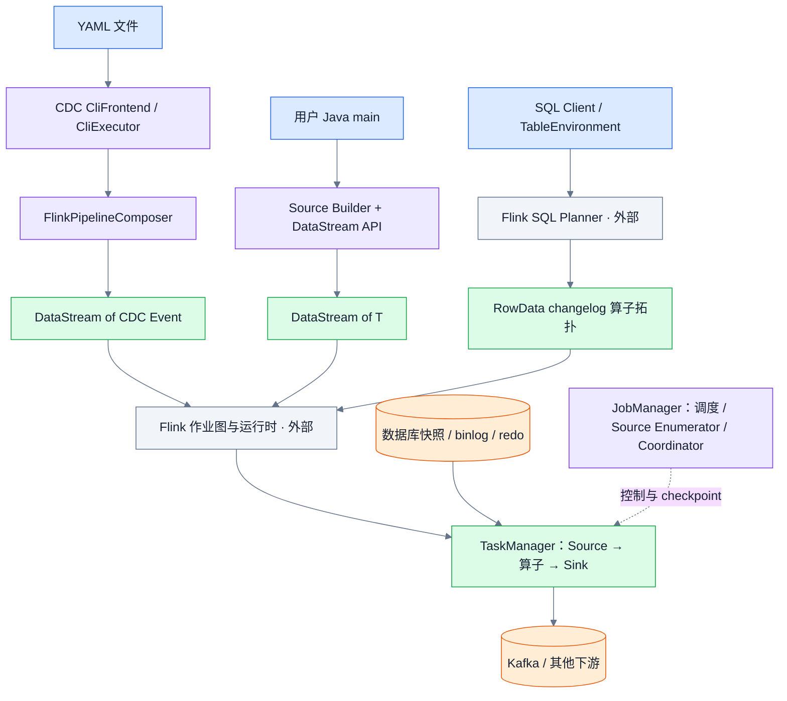

构图发生在提交端或 Application 部署的应用入口；数据库持续读取发生在任务运行之后。调用 Builder、执行 `CREATE TABLE`、解析 YAML 都不等于已经开始读取 redo。

### 数据经过哪些表示

| 阶段 | 数据表示 | 说明 |
|---|---|---|
| Oracle redo 解析结果 | LogMiner ResultSet / `LogMinerEventRow` | SCN、XID、SQL_REDO、操作码等 |
| Oracle 事务缓存 | `MemoryTransaction` / `LogMinerEvent` | 组织尚未完成事务的数据事件 |
| Debezium 输出 | Kafka Connect `SourceRecord` | 这是内存对象，不意味着发送到了 Kafka |
| CDC Source 内部 | `DataChangeEvent`、`SourceRecords`、分片状态 | 此处 Debezium `DataChangeEvent` 包装类与 Pipeline 同名概念不同 |
| DataStream 用户层 | `T`，例如 JSON 字符串、POJO | 由 `DebeziumDeserializationSchema<T>` 决定 |
| SQL 用户层 | `RowData` + `RowKind` | INSERT/UPDATE_BEFORE/UPDATE_AFTER/DELETE |
| YAML 用户层 | CDC `Event` | `DataChangeEvent`、`SchemaChangeEvent`、`FlushEvent` 等 |
| Kafka 网络层 | `ProducerRecord<byte[], byte[]>` | 由 Sink 序列化器决定 topic、key、value、headers |

不要把 Debezium Envelope、Pipeline Event、SQL RowKind 三套协议当成同一种消息。

## 3. YAML：入口、构图与提交

### 3.1 入口调用链

```text
bin/flink-cdc.sh
  → org.apache.flink.cdc.cli.CliFrontend.main(...)
  → CliExecutor.run()
      ├─ Deployment 模式：ComposeDeploymentFactory → PipelineDeploymentExecutor.deploy(...)
      └─ 普通执行：YamlPipelineDefinitionParser.parse(...)
          → PipelineDef
          → FlinkPipelineComposer.compose(...)
          → FlinkPipelineExecution.execute()
          → Flink 执行环境提交/执行作业
```

脚本负责组装 classpath 和日志配置，然后启动 Java CLI。`CliExecutor` 判断部署模式，普通路径读取 YAML 和全局配置。`PipelineDef` 保存 source、sink、route、transform、UDF 与 pipeline 配置，而不是运行时数据。

### 3.2 Composer 的真实算子顺序

`FlinkPipelineComposer.compose()` 的关键顺序如下。注意 **PostTransform 在 SchemaOperator 前面**；代码中较早创建 SchemaOperatorTranslator 对象，不代表已把 SchemaOperator 加入流。

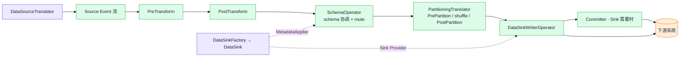

Transform 是否实际加入算子取决于规则；图展示完整可选链路。route 在 schema/data 处理过程中改变目标 TableId，不是独立启动另一个 Flink 作业。

### 3.3 插件发现与 Source/Sink 装配

| 层 | 关键调用 | 责任 |
|---|---|---|
| YAML 解析 | `YamlPipelineDefinitionParser.parse` | 解析定义并合并配置 |
| Source 工厂 | `FactoryDiscoveryUtils.getFactoryByIdentifier` | 按 source type 发现 CDC 工厂 |
| Source 实例 | `DataSourceFactory.createDataSource` | 创建数据库专用 `DataSource` |
| Source Provider | `DataSource.getEventSourceProvider` | 返回新 Source 或旧 SourceFunction 包装 |
| 加入拓扑 | `env.fromSource` / `env.addSource` | 声明 Event 流 |
| Sink 工厂 | `DataSinkTranslator.createDataSink` | 创建 `DataSink`，同时供给 MetadataApplier |
| Sink Provider | `DataSink.getEventSinkProvider` | 提供 Flink Sink 或 SinkFunction |
| 加入 Sink | `DataSinkTranslator.translate` | 使用 CDC 自己的 Writer 包装以处理 Flush/schema 协议 |

CDC Pipeline Factory 的 SPI 与 Flink SQL Table Factory 是两套接口；同名 `mysql`、`kafka` 并不代表走相同工厂。

### 3.4 YAML 提交时序

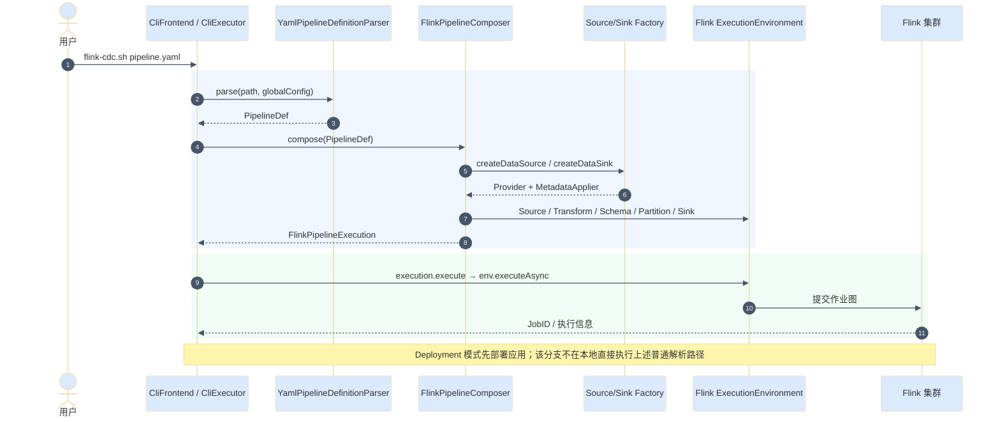

## 4. YAML：运行时数据流和 schema 协调

### 4.1 MySQL Pipeline Source

```text
MySqlDataSourceFactory
  → MySqlDataSource.getEventSourceProvider()
  → MySqlSource<Event>
      → MySqlSourceEnumerator：发现/分配快照和 binlog split
      → MySqlSourceReader / MySqlSplitReader
          → SnapshotSplitReader / BinlogSplitReader
          → Debezium SourceRecord
          → MySqlPipelineRecordEmitter + MySqlEventDeserializer
          → CDC Event
```

MySQL 有自己的 Source 实现，不应把 Oracle 通用 `IncrementalSource` 的每个类名套用到 MySQL。MySQL 的输入是 binlog，Oracle 是 redo/LogMiner，二者只在上层接口和事件适配模式上相似。

### 4.2 数据事件与 schema 事件分流

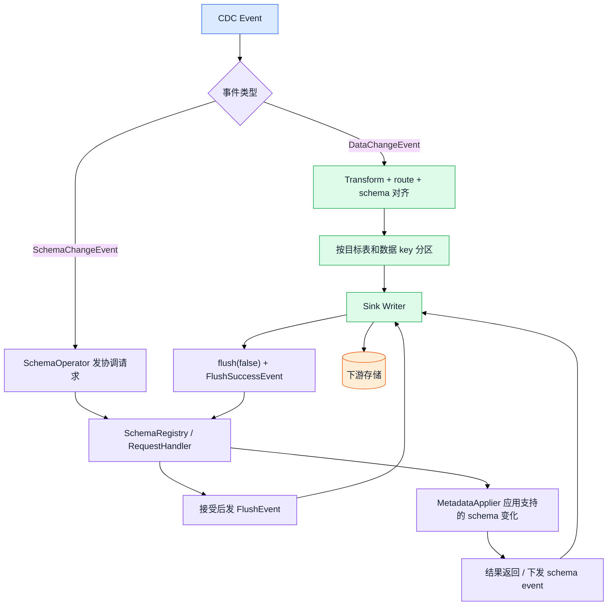

### 4.3 DDL 协调时序

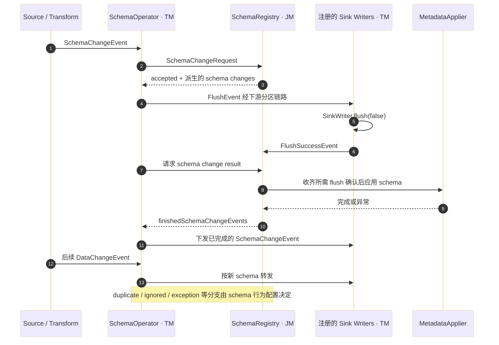

`FlushEvent` 是 CDC 的 schema 协调事件，不等同于 Flink checkpoint barrier。`MetadataApplier` 的能力取决于 Sink；不能假定所有 Sink 都会执行数据库 ALTER TABLE。

### 4.4 YAML Kafka Sink 的实际行为

`KafkaDataSink.getEventSinkProvider()` 创建外部 `KafkaSink<Event>`，设置投递保证、producer 参数和 `PipelineKafkaRecordSerializationSchema`。

序列化器先把 Event 交给 key/value serializer；如果是 `SchemaChangeEvent`，返回 `null`，**不会直接把该 schema event 作为 Kafka 消息发送**。它仍可用于更新序列化器的 schema。数据事件 topic 使用统一配置的 topic，未配置时使用 `tableId().toString()`。

`DataSinkTranslator` 不是简单一行 `stream.sinkTo()`：它创建 `DataSinkWriterOperatorFactory`，对支持两阶段提交的 Sink 构建 committer 拓扑，并适配 Flink 内部 Writer/Committer。Schema flush 与 checkpoint 提交在这里汇合，但不是同一套协议。

## 5. DataStream：Oracle 新 Source API

### 5.1 用户入口

下面是调用形态，省略连接参数和 KafkaSink 构建，不是可直接运行的完整示例：

```java
OracleSourceBuilder.OracleIncrementalSource<String> source =
    OracleSourceBuilder.OracleIncrementalSource.<String>builder()
        // hostname / port / databaseList / schemaList / tableList / 账号等
        .deserializer(new JsonDebeziumDeserializationSchema())
        .build();

DataStreamSource<String> events = env.fromSource(
    source, WatermarkStrategy.noWatermarks(), "oracle-cdc");

events.sinkTo(kafkaSink); // kafkaSink 是用户创建的外部 Flink KafkaSink<String>
env.execute("oracle-to-kafka");
```

这里用户指定 `T=String`，也可以使用自定义 deserializer 输出 POJO。CDC Source 不会自行创建 Kafka Sink。

### 5.2 构图与运行时调用链

```text
用户 main
  → OracleSourceBuilder.OracleIncrementalSource.builder()
  → OracleSourceBuilder.build()
  → OracleIncrementalSource extends JdbcIncrementalSource
  → IncrementalSource
  → env.fromSource(...)
  → 用户 map / process / keyBy / sinkTo
  → env.execute(...)

Flink 运行时回调：
  → createEnumerator / restoreEnumerator
      → IncrementalSourceEnumerator
      → HybridSplitAssigner 或 StreamSplitAssigner
  → createReader
      → IncrementalSourceReader
      → IncrementalSourceSplitReader
      → OracleDialect.createFetchTask(split)
          ├─ SnapshotSplit → OracleScanFetchTask
          └─ StreamSplit → OracleStreamFetchTask
      → IncrementalSourceRecordEmitter.emitRecord
      → DebeziumDeserializationSchema.deserialize
      → SourceOutput.collect(T)
      → 用户算子 → Sink
```

### 5.3 控制面与数据面

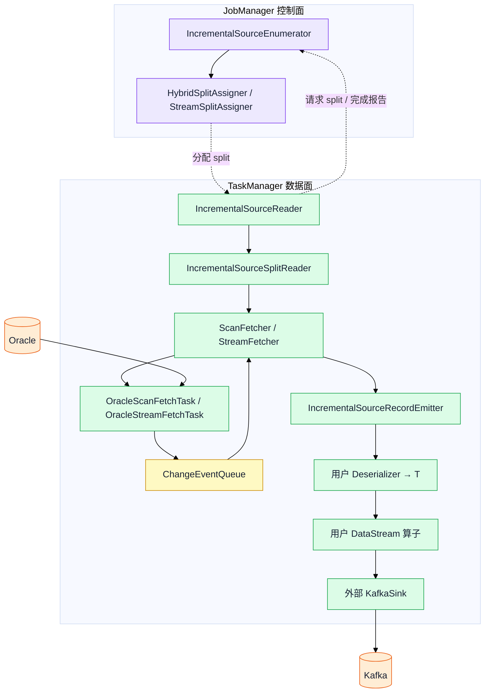

图中的队列循环表示生产与消费，不是递归 Java 调用。Enumerator 不负责持续读取 redo；FetchTask 才在 TaskManager 侧执行数据库读取。

### 5.4 关键对象职责

| 类 | 关键方法/用途 |
|---|---|
| `OracleSourceBuilder` | 收集配置并 `build()` OracleIncrementalSource |
| `OracleSourceConfigFactory` | 将 Flink CDC 配置、用户 Debezium properties 转成数据库任务配置 |
| `IncrementalSource` | 创建/恢复 Enumerator、Reader，提供状态 serializer |
| `IncrementalSourceEnumerator` | Reader 注册、split 分配、SourceEvent 处理、协调状态 |
| `HybridSplitAssigner` | initial 等启动模式下组织快照到增量的交接 |
| `StreamSplitAssigner` | 非快照模式下分配增量 split |
| `OracleChunkSplitter` | 为 Oracle 表生成快照 chunk 边界 |
| `IncrementalSourceReader` | 管理分片状态、完成报告与 checkpoint 状态 |
| `IncrementalSourceSplitReader` | 在快照/增量 Fetcher 间选择并收取结果 |
| `OracleDialect` | 数据库专用元数据、offset、chunk splitter 和 FetchTask 工厂 |
| `OracleSourceFetchTaskContext` | 准备 JDBC、schema、dispatcher、queue、offset 等上下文 |
| `IncrementalSourceRecordEmitter` | 处理水位/schema/数据/heartbeat 等记录，更新 split offset 并反序列化 |

## 6. 快照分片到持续增量

增量快照的“增量”不是只读增量数据，而是允许并行分块读取全量表，并使用日志回填协调快照期间的变更。具体是否执行快照取决于 startup mode 和恢复状态。


该图表示正常启用回填的路径。`scan.incremental.snapshot.backfill.skip` 会改变回填行为，不能在跳过回填时仍宣称采用完全相同的一致性处理过程。

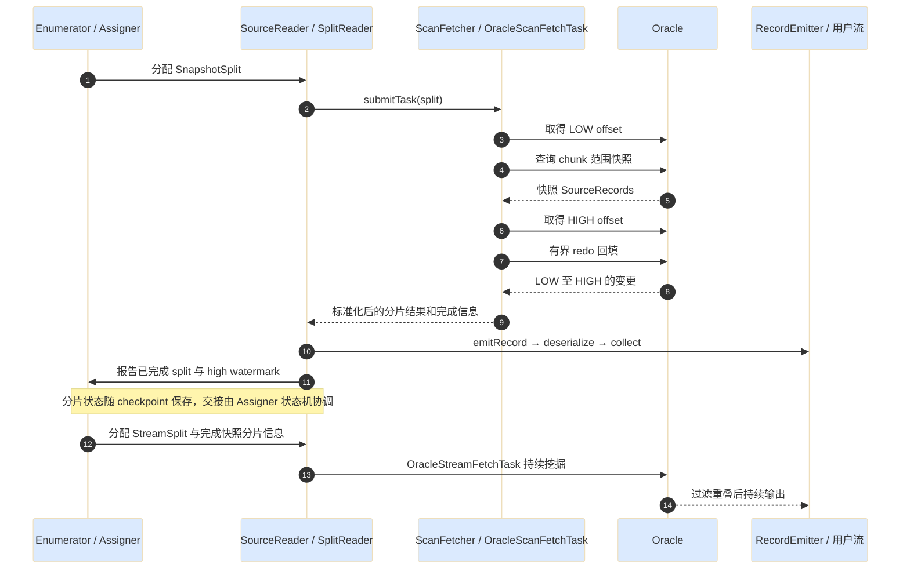

快照并行度不等于 redo 能自动按同样并行度读取：Oracle 此通用实现的持续增量由 StreamSplit 路径承担，不能仅增加 Source 并行度就认为 LogMiner 吞吐线性提升。

## 7. Oracle：LogMiner 到 SourceRecord

### 7.1 增量任务调用链

```text
IncrementalSourceStreamFetcher.submitTask(...)
  → 后台线程执行 OracleStreamFetchTask.execute(context)
  → 创建 RedoLogSplitReadTask
      extends LogMinerStreamingChangeEventSource
  → RedoLogSplitReadTask.execute(...)
  → LogMinerStreamingChangeEventSource.execute(...)
      → 选择覆盖所需 SCN 的日志
      → 加入 LogMiner / 启动 mining session
      → processor.process(startScn, endScn)
          → 查询 V$LOGMNR_CONTENTS
          → processResults / 分派操作类型
          → DML、DDL、COMMIT、ROLLBACK 等处理
      → 根据 processor 返回值更新下一批 startScn
```

### 7.2 真正的 SQL 查询边界

```sql
SELECT SCN, SQL_REDO, OPERATION_CODE, TIMESTAMP, XID, CSF,
       TABLE_NAME, SEG_OWNER, OPERATION, USERNAME, ROW_ID,
       ROLLBACK, RS_ID, STATUS, INFO, SSN, THREAD#,
       DATA_OBJ#, DATA_OBJV#, DATA_OBJD#
FROM V$LOGMNR_CONTENTS
WHERE SCN > :start_scn
  AND SCN <= :end_scn
  -- 其余条件由 LogMinerQueryBuilder 根据配置拼接
;
```

查询下界不包含、上界包含。当前补丁启动 `START_LOGMNR` 时使用 `startScn + 1` 对齐其包含式下界。SQL_REDO 长记录可能通过 CSF 连续多行返回，不能把任意 ResultSet 一行都当成完整业务 SQL。

默认 MEMORY、`lob.enabled=false` 的操作码集合排除 START 6；LOB 模式包含更多操作，并在 MEMORY 下增加 INTERNAL 记录条件。具体分支见 `LogMinerQueryBuilder.getOperationCodePredicate()`。

### 7.3 事务提交到输出

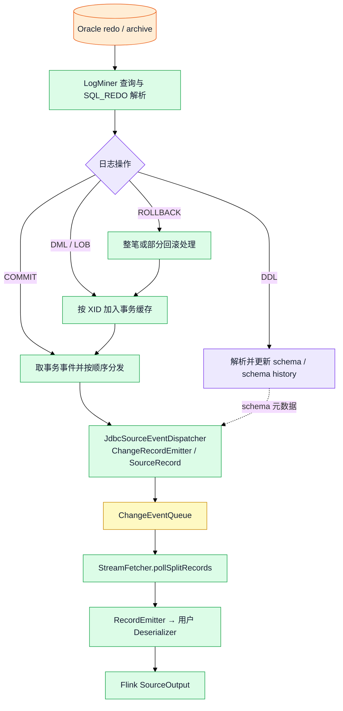

DDL/schema 路径和事务数据路径不是同一个缓存流程。框架还会处理 heartbeat、水位及状态事件；它们不一定作为普通业务记录交给用户。

### 7.4 Oracle 增量时序

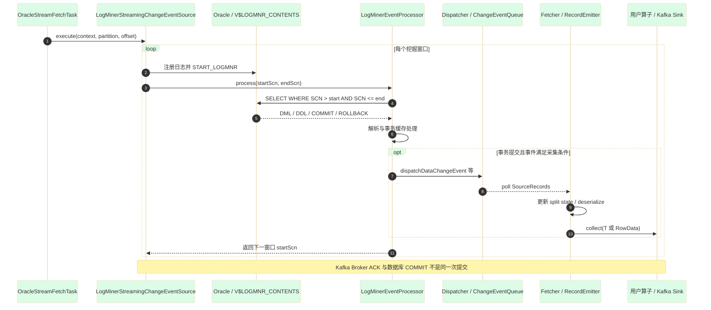

### 7.5 三种 SCN 不要混淆

| 位置 | 含义 |
|---|---|
| `startScn / endScn` | 当前数据库日志查询窗口 |
| `offsetContext.getScn()` | 恢复所需的源位点，可能保留旧事务起点 |
| commit SCN / redo-thread commit map | 已处理提交进度及重放去重相关信息 |

在 MEMORY、非 LOB 分支，`calculateNewStartScn` 可以保留旧恢复位点，同时返回前进后的 endScn；LOB 分支可能返回恢复 SCN。该差异属于 Source 内部，三种入口的 Sink 都不负责决定这个 SCN。

## 8. DataStream：旧 SourceFunction

### 8.1 另一套真实存在的 Oracle 入口

```java
DebeziumSourceFunction<String> sourceFunction =
    org.apache.flink.cdc.connectors.oracle.OracleSource.<String>builder()
        // 连接配置、表过滤、启动模式
        .deserializer(new JsonDebeziumDeserializationSchema())
        .build();

env.addSource(sourceFunction).sinkTo(kafkaSink);
env.execute("oracle-legacy-to-kafka");
```

旧入口是 `org.apache.flink.cdc.connectors.oracle.OracleSource`，新入口是 `source.OracleSourceBuilder.OracleIncrementalSource`。不要仅凭名称中的 OracleSource 判断新旧。

### 8.2 调用链与线程交接

```text
OracleSource.Builder.build()
  → DebeziumSourceFunction
  → open：创建 executor、Handover、DebeziumChangeConsumer
  → initializeState：恢复 offset 和 schema history
  → run：配置 DebeziumEngine.create(Connect.class)
      → notifying(changeConsumer)
      → executor.execute(engine)
      → 外部 Debezium Oracle connector/task 执行快照或流读取
      → DebeziumChangeConsumer.handleBatch
      → Handover
      → DebeziumChangeFetcher.runFetchLoop
      → deserializer.deserialize
      → SourceContext.collect
      → 用户算子 → Kafka Sink
```

上面的生命周期列表表示职责，Flink 实际会先初始化/恢复状态再进入正常运行；不能按列表顺序手工调用这些方法。

```mermaid
%%{init: {'theme':'base','themeVariables':{'fontFamily':'Microsoft YaHei, Arial'}}}%%
flowchart LR
  U["env.addSource"]:::entry --> SF["DebeziumSourceFunction"]:::run
  SF --> E["DebeziumEngine 后台线程"]:::run
  E --> DB["外部 Oracle connector/task<br/>快照或 LogMiner"]:::ext
  DB --> C["DebeziumChangeConsumer"]:::run
  C --> H["Handover"]:::queue
  H --> F["DebeziumChangeFetcher<br/>Source 执行线程"]:::run
  F --> DE["deserialize → collect"]:::run --> S["用户 Sink"]:::run
  CP["Flink checkpoint lock / offset / history 状态"]:::coord -.协调.-> F
  CP -.恢复.-> SF
  classDef entry fill:#dbeafe,stroke:#2563eb,color:#172033;
  classDef run fill:#dcfce7,stroke:#16a34a,color:#172033;
  classDef ext fill:#f1f5f9,stroke:#64748b,color:#172033;
  classDef queue fill:#fef9c3,stroke:#ca8a04,color:#172033;
  classDef coord fill:#ede9fe,stroke:#7c3aed,color:#172033;
```

这条路径没有 FLIP-27 的 Enumerator/SplitReader 链，也不是并行增量快照的同一套实现。SourceFunction 的 connector 不应通过任意提高并行度来重复启动多个相同采集实例。

## 9. Flink SQL：工厂、Planner 和运行时

### 9.1 SQL 从哪里进入

用户可以通过 Flink SQL Client、SQL Gateway 或 `TableEnvironment.executeSql()` 提交 SQL；这些入口属于外部 Flink，不属于 CDC CLI。

```text
CREATE TABLE oracle_source (...)
WITH ('connector' = 'oracle-cdc', ...)

CREATE TABLE kafka_sink (...)
WITH ('connector' = 'upsert-kafka' 或合适的其他 Sink, ...)

INSERT INTO kafka_sink SELECT ... FROM oracle_source
```

这是结构示意，不是完整可运行 DDL。Kafka 表要根据 changelog 语义选择 connector、主键与 format；不能把含 UPDATE/DELETE 的流当成普通 append-only JSON 流。

`CREATE TABLE` 主要注册表定义，持续采集作业通常由 `INSERT INTO`、StatementSet 执行或查询执行触发。

### 9.2 计划阶段调用链

```text
外部 Flink SQL 入口
  → SQL parse / validate / catalog / planner
  → 按 connector = oracle-cdc 发现 Table Factory
  → OracleTableSourceFactory.createDynamicTableSource(context)
      → 校验配置、物理 schema、增量快照参数、Debezium 配置
      → new OracleTableSource(...)
  → OracleTableSource.getChangelogMode()
  → OracleTableSource.getScanRuntimeProvider(scanContext)
      → RowDataDebeziumDeserializeSchema
      ├─ 增量快照开启 → OracleIncrementalSource<RowData> → SourceProvider
      └─ 增量快照关闭 → OracleSource.Builder<RowData> → SourceFunctionProvider
  → 外部 Planner 构建 Source / SQL 算子 / DynamicTableSink 运行时
  → Flink 作业图提交执行
```

这里的 parse/validate/catalog/planner 是外部阶段概括，不主张它们构成固定逐一调用的 Java 栈。真正决定 Oracle runtime 分支的是本仓库 `getScanRuntimeProvider()`。

当前公共 `SourceOptions.SCAN_INCREMENTAL_SNAPSHOT_ENABLED` 默认 `true`，Oracle Factory 使用该配置。因此应以生效配置为准，不应一概称 SQL 使用旧 SourceFunction。

### 9.3 SQL 架构图

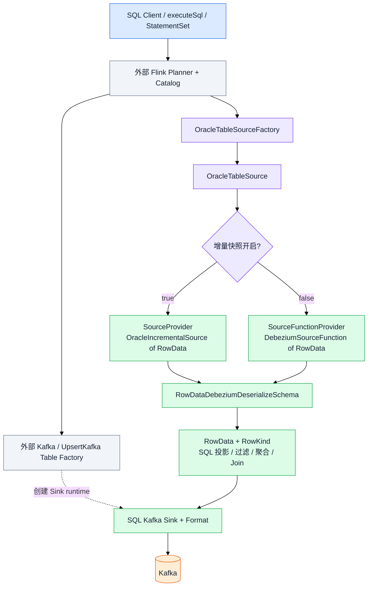

### 9.4 SourceRecord 转 SQL changelog

| Debezium 操作 | SQL RowKind |
|---|---|
| READ / CREATE | INSERT |
| DELETE | DELETE |
| UPDATE before | UPDATE_BEFORE，是否发出取决于反序列化配置 |
| UPDATE after | UPDATE_AFTER |

`RowDataDebeziumDeserializeSchema` 依据物理 RowType 转换字段类型、读取 before/after，并追加配置的元数据列。后续 SQL Planner 会依据算子和 Sink 的 changelog 能力规划转换，不能假定所有 UPDATE 都原样作为两条 Kafka 消息输出。

### 9.5 SQL 提交与运行时序

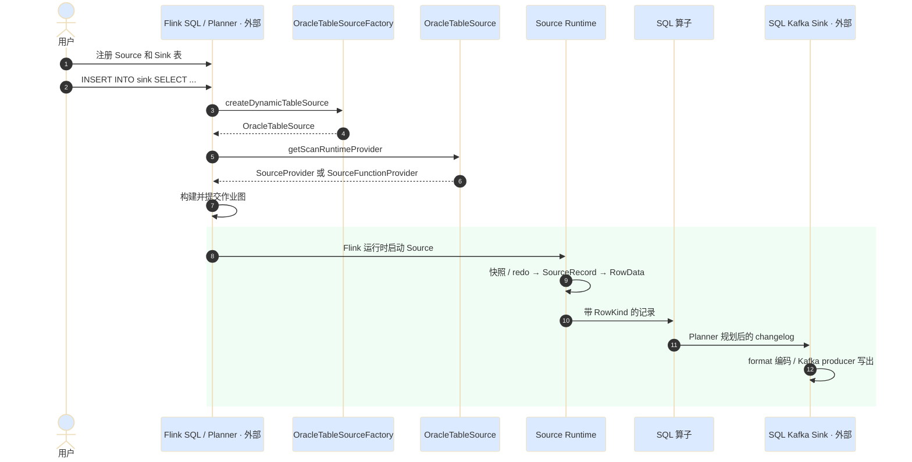

### 9.6 SQL DDL 与源库 DDL 的区别

SQL `CREATE TABLE` 描述的是 Flink 的逻辑表 schema；Oracle 的 ALTER TABLE 是源数据库 schema 变化。Debezium 内部 schema 更新不代表 SQL Planner 会自动重建运行中的 RowType。**SQL 路径没有自动接入 YAML 的 SchemaOperator / MetadataApplier 全链路。** 源表加列、改类型需要评估 SQL 表定义、类型转换和下游格式的兼容性。

## 10. 三种入口如何写 Kafka

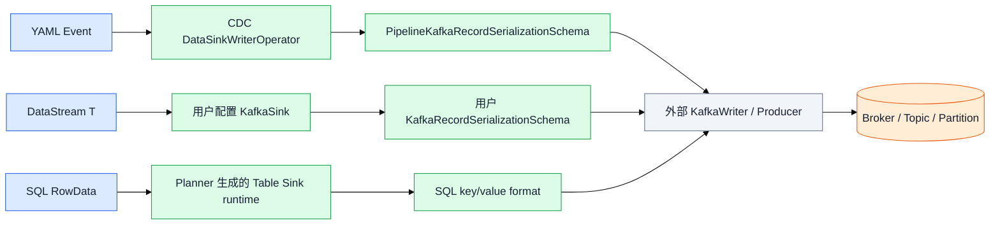

| 问题 | YAML | DataStream | SQL |
|---|---|---|---|
| 谁创建 Sink | CDC KafkaDataSinkFactory | 用户程序 | 外部 Flink Table Factory |
| 输入类型 | CDC Event | T | RowData |
| topic 决策 | Pipeline 序列化器统一 topic 或 TableId | 用户 serializer / builder | Table Sink 配置与能力 |
| key/value 编码 | Pipeline 配置的 serializer | 用户选择 | SQL format |
| schema event | 更新序列化状态；当前 Kafka serializer 不发送该事件 | 用户定义，没有自动 Pipeline 协议 | 不等同于 Pipeline schema event |
| 投递保证 | DataSink 配置 + 外部 KafkaSink 能力 | 用户配置 | SQL connector 配置 |

即使 Source 的 checkpoint 一致，也不能自动得出端到端 exactly-once。Kafka 事务保证还依赖 Sink 配置、checkpoint、唯一事务标识、超时以及消费者隔离级别等条件。普通 JSON 字符串 Sink 不会自动把 Debezium DELETE 转成 Kafka tombstone。

## 11. 线程、队列、反压和延迟

### 11.1 新 Source 路径

```text
数据库 I/O / Oracle FetchTask 后台执行
   ↓ 生产 DataChangeEvent
ChangeEventQueue
   ↓ IncrementalSourceStreamFetcher.pollSplitRecords()
SplitReader / Flink Source fetcher 交接
   ↓ SourceRecords
SourceReader 的 RecordEmitter
   ↓ 用户 deserializer
SourceOutput / Flink 算子链 / 网络 shuffle
   ↓
Sink writer / Kafka producer
```

`IncrementalSourceStreamFetcher` 中启动执行 FetchTask 的线程名为 `debezium-reader-<subtask>`。Flink SourceReader 的 fetcher 机制另有自己的线程/队列，不能把它们与 Task 主执行线程混为一个线程。

### 11.2 反压传播


归档量增长、LogMiner SQL 耗时、SQL_REDO 解析 CPU、GC、事务缓存、SQL 算子和 Kafka 都可能影响吞吐。日志中 LogMiner Lag 不是 Kafka broker 最终确认延迟；Flink Source 的 fetch/emit lag 指标也有各自采样点。

### 11.3 异常传播

旧路径通过 `Handover.reportError` 等把 Debezium engine 异常传回 Source；新路径 Fetcher 捕获后台任务异常，在消费侧检查并抛出，使 Flink 根据重启策略处理。配置错误、DDL parse 异常、日志缺失、Sink 错误所处层不同；不能只看最外层 FlinkException。

## 12. checkpoint、savepoint 与恢复

### 12.1 新 Source 保存什么

| 部位 | 状态内容/职责 |
|---|---|
| Enumerator / Assigner | 待分配、已完成分片、快照阶段进度等 PendingSplitsState |
| SourceReader | SnapshotSplit / StreamSplit 及其运行进度 |
| StreamSplit | starting offset、schema、已完成快照分片信息等 |
| SQL / 用户算子 | 聚合、Join、去重等各自 Flink state |
| Pipeline SchemaRegistry | schema 协调器状态、schema 管理相关信息 |
| Sink | Writer state / committable / 外部事务，取决于 Sink |

**不应把 Debezium 的整个 MEMORY 事务缓存理解成已逐项写入 Flink checkpoint。** 恢复依赖记录的 offset、schema 和数据库日志重放；数据库日志是否仍可用是独立条件。

### 12.2 checkpoint 时序（概念层）

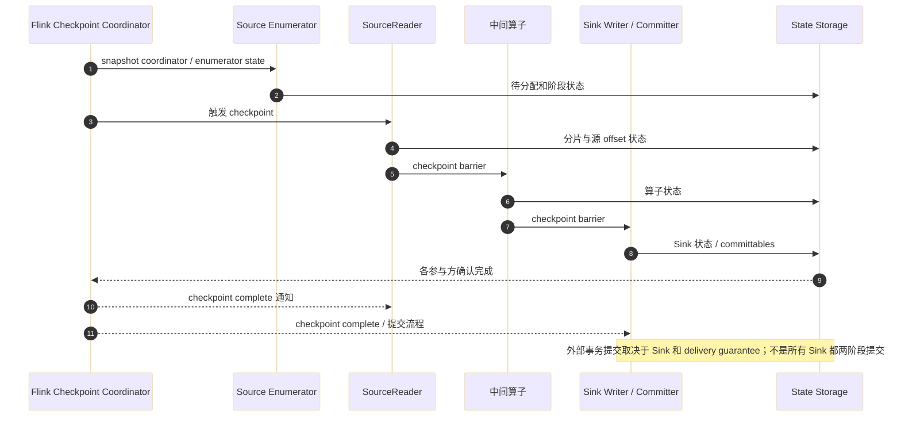

实际 barrier 对齐/非对齐、异步状态上传和调度由外部 Flink 实现；图中纵向顺序是依赖关系示意，不是要求所有存储调用串行执行。

### 12.3 旧 SourceFunction 保存什么

`DebeziumSourceFunction` 使用 `offset-states` 和 `history-records-states` 保存源 offset 与 schema history。输出和 offset 更新通过 checkpoint lock 协调，`snapshotState` 保存状态，`notifyCheckpointComplete` 处理对应的 offset 提交。恢复时重新配置内部 offset/history 存储，再启动 engine。

### 12.4 恢复流程

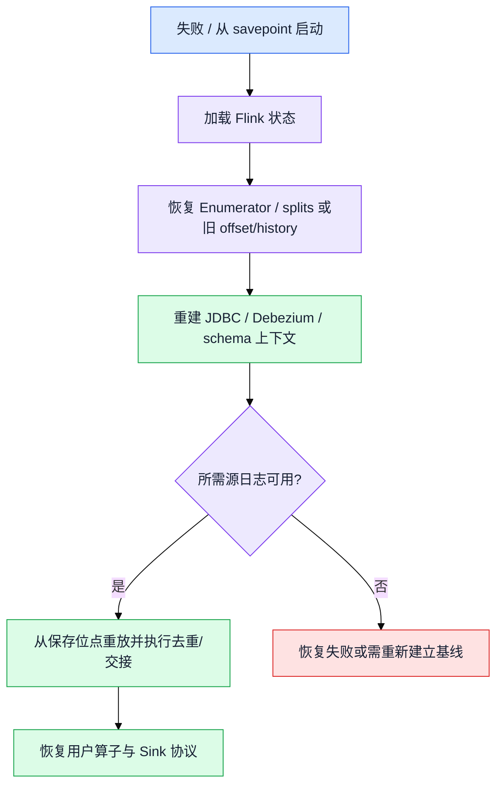

Savepoint 是 Flink 状态，不是 Oracle 归档备份。YAML、DataStream、SQL 的作业拓扑和状态结构也不同，不能默认三种入口之间可直接互换 savepoint。

## 13. 配置、依赖和改造落点

### 13.1 配置从哪里流入

| 入口 | 配置流 |
|---|---|
| YAML | YAML + 全局 Pipeline config → PipelineDef → CDC Factory Context → DataSource / DataSink |
| DataStream 新 API | Builder → OracleSourceConfigFactory → OracleSourceConfig → FetchTaskContext / Debezium config |
| DataStream 旧 API | OracleSource.Builder → Properties → DebeziumSourceFunction → engine |
| SQL | WITH options → OracleTableSourceFactory → OracleTableSource → 对应 Builder |

SQL `debezium.*` 是外层透传命名；进入 Debezium Properties 后使用 Debezium 自身键名。DataStream `.debeziumProperties(props)` 中通常直接写 `lob.enabled` 等原生键。勿把 SQL 前缀重复传给 Debezium。

### 13.2 模块依赖分层

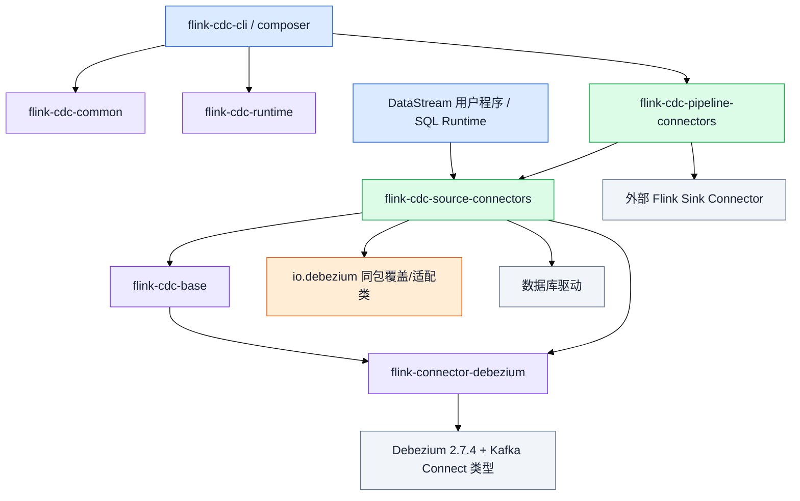

图为总体依赖分层，不表示每个数据库模块都继承同一套 base 类，也不表示每个 Pipeline Sink 都依赖 CDC Source。

### 13.3 Debezium 升级改变哪些层

- 根 POM 的 Debezium 版本与依赖组合。
- Debezium Engine、SourceRecord 消费及错误传播适配。
- SourceConfig 中 schema history 等配置名与行为适配。
- 数据库 FetchTask、dispatcher、offset/schema/context 接口适配。
- Oracle 的 `io.debezium.connector.oracle.*` 覆盖类，包含 LogMiner、事务、LOB/回滚处理等改造。
- 各数据库专用兼容修复与测试。

升级不把 YAML 自动变成 Oracle Pipeline，也不替代 Flink SQL Planner 或 Kafka Sink。有关每个改造类的逐项 diff、动机与验证，继续参阅同目录既有迁移文档；本文聚焦架构，不将上游所有行为归功于本地补丁。

### 13.4 JAR 的角色

| JAR/模块 | 用途 |
|---|---|
| `flink-connector-oracle-cdc` | DataStream / Table Source 实现及 Oracle 适配 |
| `flink-sql-connector-oracle-cdc` | 面向部署的依赖聚合/打包模块 |
| `flink-cdc-pipeline-connector-*` | CDC YAML 的 Factory、Event 适配与 Sink 集成 |
| Oracle JDBC 驱动 | JDBC 查询与 LogMiner 调用所需 |
| Kafka connector / SQL format | 输出 Kafka；不由 Oracle Source 自动提供所有部署依赖 |
| `*-sources.jar` | 开发调试源码，不是运行时 connector |

同时放置重复版本的瘦 JAR、聚合 JAR 和原始 Debezium JAR 可能产生类加载冲突；具体部署依赖要按构建产物、Flink 集群已有依赖和用户打包方式确认。

## 14. 源码导航与排查方法

以下索引由同一源码树生成，链接定位到该基线中的实际文件及关键方法。为了便于复制项目，链接以本文所在目录为基准；行号作为阅读提示单独显示。

### YAML 入口与构图

| 类 | 方法位置 | 源码 |
|---|---|---|
| `CliFrontend` | `main`，第 54 行 | [打开源码](../../flink-cdc-cli/src/main/java/org/apache/flink/cdc/cli/CliFrontend.java) |
| `CliExecutor` | `run`，第 70 行 | [打开源码](../../flink-cdc-cli/src/main/java/org/apache/flink/cdc/cli/CliExecutor.java) |
| `YamlPipelineDefinitionParser` | `parse`，第 93 行 | [打开源码](../../flink-cdc-cli/src/main/java/org/apache/flink/cdc/cli/parser/YamlPipelineDefinitionParser.java) |
| `FlinkPipelineComposer` | `compose`，第 91 行 | [打开源码](../../flink-cdc-composer/src/main/java/org/apache/flink/cdc/composer/flink/FlinkPipelineComposer.java) |
| `FlinkPipelineExecution` | `execute`，第 42 行 | [打开源码](../../flink-cdc-composer/src/main/java/org/apache/flink/cdc/composer/flink/FlinkPipelineExecution.java) |
| `FactoryDiscoveryUtils` | `getFactoryByIdentifier`，第 49 行 | [打开源码](../../flink-cdc-composer/src/main/java/org/apache/flink/cdc/composer/utils/FactoryDiscoveryUtils.java) |
| `DataSourceTranslator` | `translate`，第 42 行 | [打开源码](../../flink-cdc-composer/src/main/java/org/apache/flink/cdc/composer/flink/translator/DataSourceTranslator.java) |
| `DataSinkTranslator` | `translate`，第 80 行 | [打开源码](../../flink-cdc-composer/src/main/java/org/apache/flink/cdc/composer/flink/translator/DataSinkTranslator.java) |
| `TransformTranslator` | `translatePreTransform`，第 38 行 | [打开源码](../../flink-cdc-composer/src/main/java/org/apache/flink/cdc/composer/flink/translator/TransformTranslator.java) |
| `SchemaOperatorTranslator` | `translate`，第 55 行 | [打开源码](../../flink-cdc-composer/src/main/java/org/apache/flink/cdc/composer/flink/translator/SchemaOperatorTranslator.java) |
| `PartitioningTranslator` | `translate`，第 40 行 | [打开源码](../../flink-cdc-composer/src/main/java/org/apache/flink/cdc/composer/flink/translator/PartitioningTranslator.java) |

### YAML 插件与运行时

| 类 | 方法位置 | 源码 |
|---|---|---|
| `MySqlDataSourceFactory` | `createDataSource`，第 98 行 | [打开源码](../../flink-cdc-connect/flink-cdc-pipeline-connectors/flink-cdc-pipeline-connector-mysql/src/main/java/org/apache/flink/cdc/connectors/mysql/factory/MySqlDataSourceFactory.java) |
| `MySqlDataSource` | `getEventSourceProvider`，第 45 行 | [打开源码](../../flink-cdc-connect/flink-cdc-pipeline-connectors/flink-cdc-pipeline-connector-mysql/src/main/java/org/apache/flink/cdc/connectors/mysql/source/MySqlDataSource.java) |
| `MySqlPipelineRecordEmitter` | `类定义`，第 61 行 | [打开源码](../../flink-cdc-connect/flink-cdc-pipeline-connectors/flink-cdc-pipeline-connector-mysql/src/main/java/org/apache/flink/cdc/connectors/mysql/source/reader/MySqlPipelineRecordEmitter.java) |
| `MySqlEventDeserializer` | `类定义`，第 52 行 | [打开源码](../../flink-cdc-connect/flink-cdc-pipeline-connectors/flink-cdc-pipeline-connector-mysql/src/main/java/org/apache/flink/cdc/connectors/mysql/source/MySqlEventDeserializer.java) |
| `SchemaOperator` | `processElement`，第 251 行 | [打开源码](../../flink-cdc-runtime/src/main/java/org/apache/flink/cdc/runtime/operators/schema/SchemaOperator.java) |
| `SchemaRegistry` | `handleCoordinationRequest`，第 265 行 | [打开源码](../../flink-cdc-runtime/src/main/java/org/apache/flink/cdc/runtime/operators/schema/coordinator/SchemaRegistry.java) |
| `SchemaRegistryRequestHandler` | `类定义`，第 65 行 | [打开源码](../../flink-cdc-runtime/src/main/java/org/apache/flink/cdc/runtime/operators/schema/coordinator/SchemaRegistryRequestHandler.java) |
| `DataSinkWriterOperator` | `processElement`，第 150 行 | [打开源码](../../flink-cdc-runtime/src/main/java/org/apache/flink/cdc/runtime/operators/sink/DataSinkWriterOperator.java) |
| `KafkaDataSinkFactory` | `createDataSink`，第 53 行 | [打开源码](../../flink-cdc-connect/flink-cdc-pipeline-connectors/flink-cdc-pipeline-connector-kafka/src/main/java/org/apache/flink/cdc/connectors/kafka/sink/KafkaDataSinkFactory.java) |
| `KafkaDataSink` | `getEventSinkProvider`，第 78 行 | [打开源码](../../flink-cdc-connect/flink-cdc-pipeline-connectors/flink-cdc-pipeline-connector-kafka/src/main/java/org/apache/flink/cdc/connectors/kafka/sink/KafkaDataSink.java) |
| `PipelineKafkaRecordSerializationSchema` | `serialize`，第 96 行 | [打开源码](../../flink-cdc-connect/flink-cdc-pipeline-connectors/flink-cdc-pipeline-connector-kafka/src/main/java/org/apache/flink/cdc/connectors/kafka/sink/PipelineKafkaRecordSerializationSchema.java) |

### Oracle 新 API 与通用 Source

| 类 | 方法位置 | 源码 |
|---|---|---|
| `OracleSourceBuilder` | `build`，第 257 行 | [打开源码](../../flink-cdc-connect/flink-cdc-source-connectors/flink-connector-oracle-cdc/src/main/java/org/apache/flink/cdc/connectors/oracle/source/OracleSourceBuilder.java) |
| `OracleSourceConfigFactory` | `create`，第 63 行 | [打开源码](../../flink-cdc-connect/flink-cdc-source-connectors/flink-connector-oracle-cdc/src/main/java/org/apache/flink/cdc/connectors/oracle/source/config/OracleSourceConfigFactory.java) |
| `IncrementalSource` | `createReader`，第 114 行 | [打开源码](../../flink-cdc-connect/flink-cdc-source-connectors/flink-cdc-base/src/main/java/org/apache/flink/cdc/connectors/base/source/IncrementalSource.java) |
| `IncrementalSourceEnumerator` | `类定义`，第 68 行 | [打开源码](../../flink-cdc-connect/flink-cdc-source-connectors/flink-cdc-base/src/main/java/org/apache/flink/cdc/connectors/base/source/enumerator/IncrementalSourceEnumerator.java) |
| `HybridSplitAssigner` | `类定义`，第 50 行 | [打开源码](../../flink-cdc-connect/flink-cdc-source-connectors/flink-cdc-base/src/main/java/org/apache/flink/cdc/connectors/base/source/assigner/HybridSplitAssigner.java) |
| `StreamSplitAssigner` | `类定义`，第 41 行 | [打开源码](../../flink-cdc-connect/flink-cdc-source-connectors/flink-cdc-base/src/main/java/org/apache/flink/cdc/connectors/base/source/assigner/StreamSplitAssigner.java) |
| `OracleChunkSplitter` | `类定义`，第 45 行 | [打开源码](../../flink-cdc-connect/flink-cdc-source-connectors/flink-connector-oracle-cdc/src/main/java/org/apache/flink/cdc/connectors/oracle/source/assigner/splitter/OracleChunkSplitter.java) |
| `OracleDialect` | `createFetchTask`，第 143 行 | [打开源码](../../flink-cdc-connect/flink-cdc-source-connectors/flink-connector-oracle-cdc/src/main/java/org/apache/flink/cdc/connectors/oracle/source/OracleDialect.java) |
| `IncrementalSourceReader` | `snapshotState`，第 153 行 | [打开源码](../../flink-cdc-connect/flink-cdc-source-connectors/flink-cdc-base/src/main/java/org/apache/flink/cdc/connectors/base/source/reader/IncrementalSourceReader.java) |
| `IncrementalSourceSplitReader` | `fetch`，第 94 行 | [打开源码](../../flink-cdc-connect/flink-cdc-source-connectors/flink-cdc-base/src/main/java/org/apache/flink/cdc/connectors/base/source/reader/IncrementalSourceSplitReader.java) |
| `IncrementalSourceScanFetcher` | `类定义`，第 58 行 | [打开源码](../../flink-cdc-connect/flink-cdc-source-connectors/flink-cdc-base/src/main/java/org/apache/flink/cdc/connectors/base/source/reader/external/IncrementalSourceScanFetcher.java) |
| `IncrementalSourceStreamFetcher` | `submitTask`，第 82 行 | [打开源码](../../flink-cdc-connect/flink-cdc-source-connectors/flink-cdc-base/src/main/java/org/apache/flink/cdc/connectors/base/source/reader/external/IncrementalSourceStreamFetcher.java) |
| `IncrementalSourceRecordEmitter` | `emitRecord`，第 83 行 | [打开源码](../../flink-cdc-connect/flink-cdc-source-connectors/flink-cdc-base/src/main/java/org/apache/flink/cdc/connectors/base/source/reader/IncrementalSourceRecordEmitter.java) |
| `AbstractScanFetchTask` | `execute`，第 49 行 | [打开源码](../../flink-cdc-connect/flink-cdc-source-connectors/flink-cdc-base/src/main/java/org/apache/flink/cdc/connectors/base/source/reader/external/AbstractScanFetchTask.java) |
| `OracleScanFetchTask` | `executeDataSnapshot`，第 73 行 | [打开源码](../../flink-cdc-connect/flink-cdc-source-connectors/flink-connector-oracle-cdc/src/main/java/org/apache/flink/cdc/connectors/oracle/source/reader/fetch/OracleScanFetchTask.java) |
| `OracleStreamFetchTask` | `execute`，第 56 行 | [打开源码](../../flink-cdc-connect/flink-cdc-source-connectors/flink-connector-oracle-cdc/src/main/java/org/apache/flink/cdc/connectors/oracle/source/reader/fetch/OracleStreamFetchTask.java) |
| `OracleSourceFetchTaskContext` | `类定义`，第 76 行 | [打开源码](../../flink-cdc-connect/flink-cdc-source-connectors/flink-connector-oracle-cdc/src/main/java/org/apache/flink/cdc/connectors/oracle/source/reader/fetch/OracleSourceFetchTaskContext.java) |

### Oracle 日志与事务

| 类 | 方法位置 | 源码 |
|---|---|---|
| `LogMinerStreamingChangeEventSource` | `execute`，第 166 行 | [打开源码](../../flink-cdc-connect/flink-cdc-source-connectors/flink-connector-oracle-cdc/src/main/java/io/debezium/connector/oracle/logminer/LogMinerStreamingChangeEventSource.java) |
| `LogMinerQueryBuilder` | `build`，第 82 行 | [打开源码](../../flink-cdc-connect/flink-cdc-source-connectors/flink-connector-oracle-cdc/src/main/java/io/debezium/connector/oracle/logminer/LogMinerQueryBuilder.java) |
| `AbstractLogMinerEventProcessor` | `process`，第 233 行 | [打开源码](../../flink-cdc-connect/flink-cdc-source-connectors/flink-connector-oracle-cdc/src/main/java/io/debezium/connector/oracle/logminer/processor/AbstractLogMinerEventProcessor.java) |
| `MemoryLogMinerEventProcessor` | `calculateNewStartScn`，第 353 行 | [打开源码](../../flink-cdc-connect/flink-cdc-source-connectors/flink-connector-oracle-cdc/src/main/java/io/debezium/connector/oracle/logminer/processor/memory/MemoryLogMinerEventProcessor.java) |
| `JdbcSourceEventDispatcher` | `类定义`，第 65 行 | [打开源码](../../flink-cdc-connect/flink-cdc-source-connectors/flink-cdc-base/src/main/java/org/apache/flink/cdc/connectors/base/relational/JdbcSourceEventDispatcher.java) |

### SQL 与旧 API

| 类 | 方法位置 | 源码 |
|---|---|---|
| `OracleTableSourceFactory` | `createDynamicTableSource`，第 69 行 | [打开源码](../../flink-cdc-connect/flink-cdc-source-connectors/flink-connector-oracle-cdc/src/main/java/org/apache/flink/cdc/connectors/oracle/table/OracleTableSourceFactory.java) |
| `OracleTableSource` | `getScanRuntimeProvider`，第 153 行 | [打开源码](../../flink-cdc-connect/flink-cdc-source-connectors/flink-connector-oracle-cdc/src/main/java/org/apache/flink/cdc/connectors/oracle/table/OracleTableSource.java) |
| `RowDataDebeziumDeserializeSchema` | `deserialize`，第 121 行 | [打开源码](../../flink-cdc-connect/flink-cdc-source-connectors/flink-connector-debezium/src/main/java/org/apache/flink/cdc/debezium/table/RowDataDebeziumDeserializeSchema.java) |
| `DebeziumSourceFunction` | `run`，第 371 行 | [打开源码](../../flink-cdc-connect/flink-cdc-source-connectors/flink-connector-debezium/src/main/java/org/apache/flink/cdc/debezium/DebeziumSourceFunction.java) |
| `DebeziumChangeConsumer` | `handleBatch`，第 52 行 | [打开源码](../../flink-cdc-connect/flink-cdc-source-connectors/flink-connector-debezium/src/main/java/org/apache/flink/cdc/debezium/internal/DebeziumChangeConsumer.java) |
| `DebeziumChangeFetcher` | `runFetchLoop`，第 146 行 | [打开源码](../../flink-cdc-connect/flink-cdc-source-connectors/flink-connector-debezium/src/main/java/org/apache/flink/cdc/debezium/internal/DebeziumChangeFetcher.java) |
| `Handover` | `类定义`，第 53 行 | [打开源码](../../flink-cdc-connect/flink-cdc-source-connectors/flink-connector-debezium/src/main/java/org/apache/flink/cdc/debezium/internal/Handover.java) |


### 14.1 一条事件在哪里打断点

| 想观察什么 | 优先位置 |
|---|---|
| YAML 怎么加载插件 | FactoryDiscoveryUtils / DataSourceTranslator / DataSinkTranslator |
| YAML 真实算子顺序 | FlinkPipelineComposer.compose |
| SQL 选了哪个 Oracle API | OracleTableSource.getScanRuntimeProvider |
| Source 分配了什么任务 | IncrementalSourceEnumerator / IncrementalSourceSplitReader |
| Oracle 全量读取 | OracleScanFetchTask |
| Oracle 增量 SQL | LogMinerQueryBuilder.build / AbstractLogMinerEventProcessor.process |
| 事务何时输出 | AbstractLogMinerEventProcessor 的提交处理 |
| SourceRecord 如何变为用户对象 | IncrementalSourceRecordEmitter / DebeziumDeserializationSchema |
| SQL 更新如何变成 RowKind | RowDataDebeziumDeserializeSchema.deserialize |
| YAML DDL 为何等待 | SchemaOperator / SchemaRegistryRequestHandler / Sink flush |
| Kafka topic/key/value 从哪里来 | PipelineKafkaRecordSerializationSchema 或用户/SQL serializer |
| 旧 API 后台异常 | DebeziumSourceFunction / DebeziumChangeConsumer / Handover |

### 14.2 从日志认出链路

- 出现 CLI、Composer、SchemaOperator、SchemaRegistry：优先检查 YAML Pipeline 层。
- 出现 IncrementalSourceReader、OracleStreamFetchTask：新 Oracle Source API 路径。
- 出现 DebeziumSourceFunction、DebeziumChangeFetcher、Handover：旧 SourceFunction 路径。
- SQL 任务也可能出现上述新旧 Source 类；需要结合 OracleTableSource 配置判断，不能只凭任务名。
- 出现 LogMinerEventProcessor：说明进入 Oracle 日志处理层，不能单靠它区分 SQL 与 DataStream。

## 15. 如何扩展与容易混淆的边界

### 15.1 如果要增加 Oracle YAML 支持

这不是新增一份 YAML 即可，需要补齐一整个 Pipeline Source 插件：

1. Oracle `DataSourceFactory`，定义 type、必填/可选配置并注册 CDC Factory SPI。
2. Oracle `DataSource` 与 `EventSourceProvider`，连接已有 Oracle Source。
3. 将 Oracle SourceRecord 转为 CDC `Event`，包括 CreateTable、DDL 和数据变化，而不只是 JSON。
4. 正确提供 schema/metadata 访问、Oracle 类型转换、启动/恢复时 schema 补发行为。
5. 验证快照、增量、DDL、路由、transform、Sink flush、checkpoint 恢复及 LOB 语义。

### 15.2 如果只想改变 Oracle 到 Kafka 的消息

- DataStream：优先改用户 deserializer 和 Kafka serializer。
- SQL：优先改表 schema、查询和 Sink format/changelog 配置。
- 不应为改变 JSON 字段就直接改 LogMiner 事务缓存。

### 15.3 必须明确的十个事实

1. YAML Pipeline 最终也构建 Flink DataStream 作业，但它有自己的 Event 和 schema 协调协议。
2. Flink SQL 不经过 CDC 的 YamlPipelineDefinitionParser 或 FlinkPipelineComposer。
3. `SourceRecord` 不是 Kafka 网络发送操作。
4. Oracle CDC Source 本身不承担 Kafka Sink 的职责。
5. Oracle 新 Source API 与旧 SourceFunction 都存在，SQL 可按配置选择分支。
6. MySQL Pipeline 的底层是 MySQL 专用 Source，不是 Oracle 的类改个名字。
7. Source 快照并行不意味着单条日志增量链也能同倍数并行。
8. 数据库 COMMIT、Flink checkpoint complete、Kafka 事务 commit 是不同事件。
9. Pipeline FlushEvent 与 checkpoint barrier 是不同协议。
10. 当前运行有输出不等于任何 savepoint 都能在源日志缺失时恢复。

---

**验证范围**：方法与路径静态核对、文档链接检查、Mermaid 语法检查记录随交付提供。本文不修改连接器代码、不重新部署任务、不触发数据库操作。
