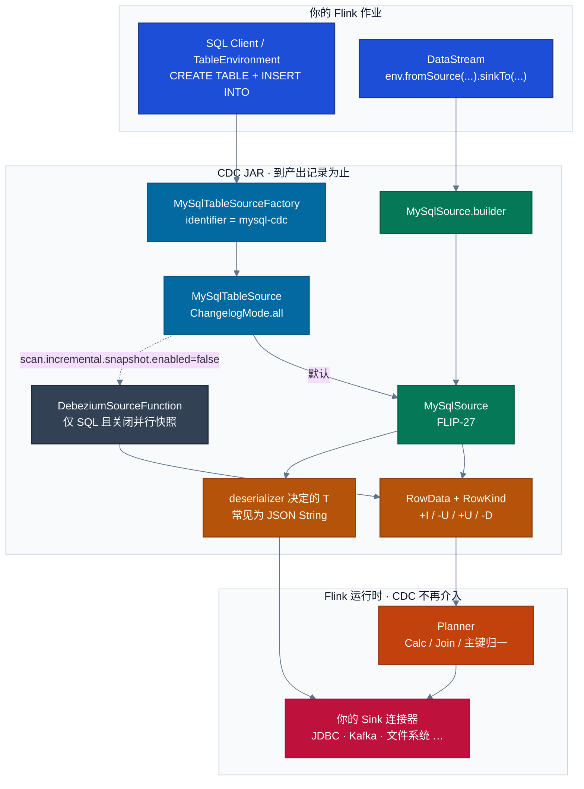
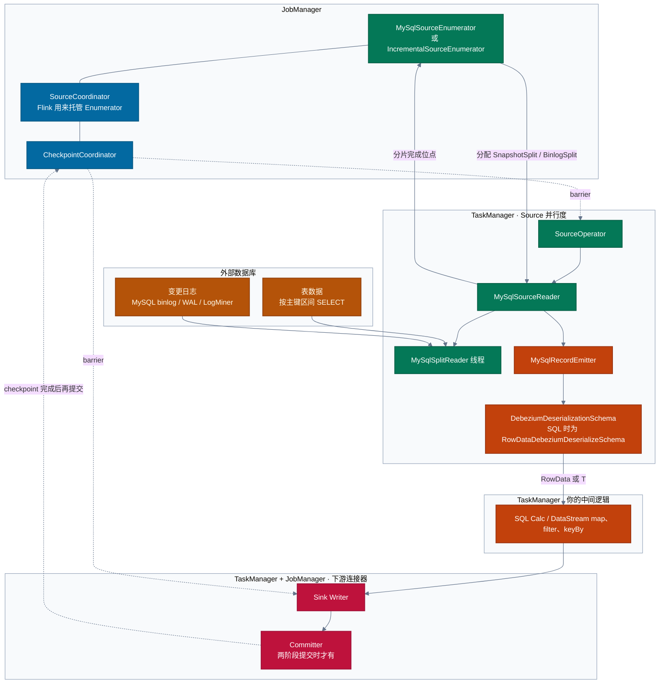
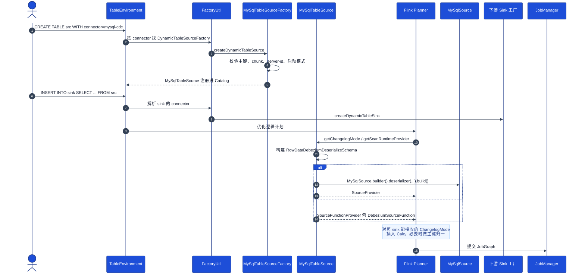
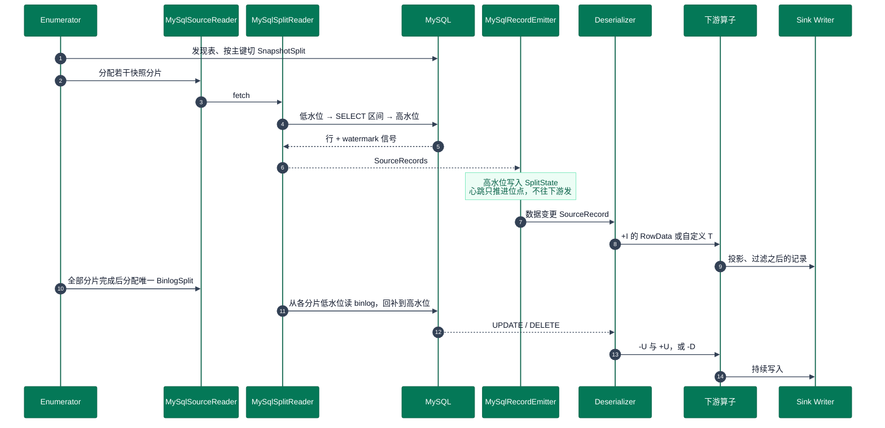
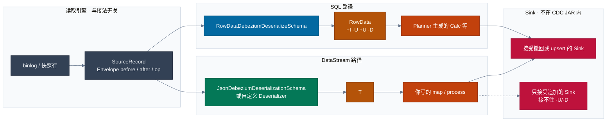
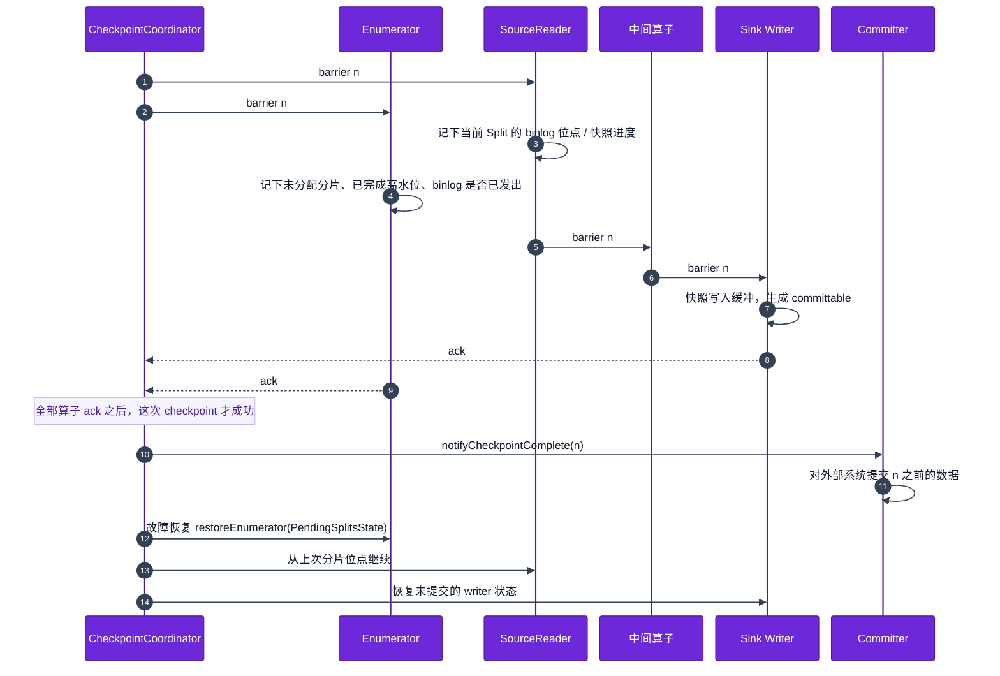
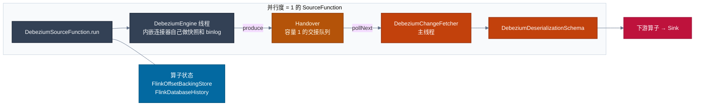

# 在 Flink 作业里引入 CDC JAR：Source 到 Sink

本文对应本仓库 **Flink CDC 3.2.1 + Debezium 2.7.4.Final + Flink 1.18.1**。讲的是把 `flink-sql-connector-*-cdc` 或 `flink-connector-*-cdc` 放进自己的 Flink 作业，而不是走 `flink-cdc.sh` 的 YAML Pipeline。

YAML Pipeline 的组图、`SchemaRegistry`、`DataSink` 见 [源码架构导读](源码架构导读.md)。那条链路在本文里不存在。

先记住边界：

> **CDC JAR 只提供 Source。** 它把数据库变更变成 Flink 记录后就结束。中间的过滤、关联、聚合由 Flink 算子完成，Sink 是另一个 Flink 连接器（JDBC、Kafka、Paimon 等）。表结构不会自动演进，`CREATE TABLE` 里写死的列就是运行时的行类型。

---

## 1. 两种接法，同一颗读引擎

| 写法 | 你引入的包 | 第一行用户代码 | CDC 侧入口 |
| --- | --- | --- | --- |
| Flink SQL / Table API | `flink-sql-connector-mysql-cdc` 打进 `$FLINK_HOME/lib` | `CREATE TABLE ... WITH ('connector'='mysql-cdc')` | `MySqlTableSourceFactory` |
| DataStream API | Maven 依赖 `flink-connector-mysql-cdc` | `MySqlSource.<T>builder()...build()` | `MySqlSource` |

SQL 的 fat jar 用 shade 把 Debezium、binlog 客户端、`flink-connector-debezium` 打在一起。SPI 文件是：

```text
META-INF/services/org.apache.flink.table.factories.Factory
→ org.apache.flink.cdc.connectors.mysql.table.MySqlTableSourceFactory
```

DataStream 不走这张 SPI。`MySqlSource` 实现 Flink 的 `Source<T, MySqlSplit, PendingSplitsState>`，由 `StreamExecutionEnvironment.fromSource` 直接挂上。

默认 `scan.incremental.snapshot.enabled = true`，SQL 也会构建这个 `MySqlSource`。只有关掉并行快照时，SQL 才退回 `DebeziumSourceFunction`。



其它库的 SQL identifier 同样是 `*-cdc`，读引擎见上一篇里的 `IncrementalSource`：

| `connector` | 工厂 |
| --- | --- |
| `mysql-cdc` | `MySqlTableSourceFactory` |
| `postgres-cdc` | `PostgreSQLTableFactory` |
| `oracle-cdc` | `OracleTableSourceFactory` |
| `sqlserver-cdc` | `SqlServerTableFactory` |
| `db2-cdc` | `Db2TableSourceFactory` |
| `mongodb-cdc` | `MongoDBTableSourceFactory` |
| `oceanbase-cdc` | `OceanBaseTableSourceFactory` |
| `tidb-cdc` | `TiDBTableSourceFactory` |
| `vitess-cdc` | `VitessTableFactory` |

MySQL 是自己的 `MySqlSource`。PostgreSQL、Oracle、SQL Server、Db2、MongoDB 的新 Source 继承 `IncrementalSource`。OceanBase、TiDB、Vitess 仍是 SourceFunction，没有分片 Enumerator。

---

## 2. 完整架构

作业提交之后，CDC 相关进程只有两处：JobManager 上的 SplitEnumerator，TaskManager 上的 SourceReader。Sink 的 Writer 和 Committer 属于下游连接器，跟 CDC 类没有调用关系，只通过 checkpoint barrier 对齐。



和 Pipeline 对照，这张图里没有这些类：

| Pipeline 才有 | 本路径里谁代替 |
| --- | --- |
| `SchemaOperator` / `SchemaRegistry` | 没有。列在规划期就固定 |
| `PreTransform` / `PostTransform` | SQL 的 `SELECT`、`WHERE`，或 DataStream 算子 |
| `route` | 没有。多表要自己在 SQL 里 `UNION`，或 DataStream 里解析 JSON |
| `MetadataApplier` | 没有。下游建表由你或 Sink 连接器负责 |
| `Event` | SQL 是 `RowData`；DataStream 是 deserializer 的 `T` |

---

## 3. SQL：从建表到 INSERT 的时序

`CREATE TABLE` 只注册元数据，不会连数据库。真正创建 `MySqlSource` 发生在语句被翻译成 JobGraph 的时候，也就是 `INSERT INTO` 或 `TableResult.execute`。

`MySqlTableSourceFactory.createDynamicTableSource` 用 `FactoryUtil` 校验 WITH 参数。必填项是 `hostname`、`username`、`password`、`database-name`、`table-name`。`debezium.*` 和 `jdbc.properties.*` 被 `validateExcept` 放过，原样塞进 Debezium / JDBC 配置。

并行快照打开时，工厂还会检查物理主键或 `scan.incremental.snapshot.chunk-key-column`。没有切分键就不能按主键区间切片。



`MySqlTableSource.getChangelogMode` 返回 `ChangelogMode.all()`。一条更新在下游会看到两行：`UPDATE_BEFORE` 和 `UPDATE_AFTER`。Sink 的 `getChangelogMode` 必须能接住这组变更，否则规划期直接失败。只接受追加流的 Sink 不能直接接这个 Source。

`getScanRuntimeProvider` 里两种运行时：

| 条件 | 返回 | 作业里的算子 |
| --- | --- | --- |
| `enableParallelRead == true` | `SourceProvider.of(MySqlSource)` | FLIP-27 `SourceOperator`，并行度可大于 1 |
| `enableParallelRead == false` | `SourceFunctionProvider.of(DebeziumSourceFunction, false)` | 旧 Source，并行度必须是 1 |

第二个参数 `false` 表示无界流：快照读完后继续读日志。`scan.startup.mode = snapshot` 时 `MySqlSource.getBoundedness` 返回 `BOUNDED`，读完快照作业可以结束。

启动模式由 `scan.startup.mode` 控制，默认 `initial`（先快照再增量）：

| 取值 | Enumerator 行为 |
| --- | --- |
| `initial` | `MySqlHybridSplitAssigner`：先快照分片，再一个 binlog 分片 |
| `latest-offset` / `earliest-offset` / `specific-offset` / `timestamp` | 纯增量时走 `MySqlBinlogSplitAssigner`，不切快照 |
| `snapshot` | 只做快照，有界 |

---

## 4. 运行时：一条记录从库到 Sink

下面是默认的 FLIP-27 路径。DataStream 与 SQL 在 `deserializer` 之前完全相同，之后 SQL 多一层 Planner 生成的算子。



`MySqlRecordEmitter.processElement` 把 Debezium 的 `SourceRecord` 分成四类，只有数据变更默认往下发：

| 记录 | 处理 |
| --- | --- |
| Watermark | 快照分片记下高水位，不输出业务行 |
| Schema change | 默认 `includeSchemaChanges = false`，只记在 binlog split 的表结构里，不输出 |
| Data change | 更新分片起始位点，交给 deserializer |
| Heartbeat | 只推进位点，防止长时间无业务数据时 checkpoint 位点不前移 |

SQL 的 deserializer 是 `RowDataDebeziumDeserializeSchema.deserialize`。它读 Debezium Envelope 的 `op`：

| Envelope.Operation | 发出的 RowData |
| --- | --- |
| `READ`（快照）、`CREATE`（插入） | 一行 `RowKind.INSERT`，取 `after` |
| `DELETE` | 一行 `RowKind.DELETE`，取 `before` |
| `UPDATE` | 先一行 `UPDATE_BEFORE`（`before`），再一行 `UPDATE_AFTER`（`after`） |

列转换按 `CREATE TABLE` 的物理 `RowType` 做，时区用 `server-time-zone`。`op`、库名、表名这类元数据列只有在表定义里声明了 metadata 时才由 `AppendMetadataCollector` 追加。DDL 不会变成 Flink 的 schema 变更事件。

DataStream 若使用 `JsonDebeziumDeserializationSchema`，下游拿到的是 JSON 字符串，没有 `RowKind`。更新的 before/after 都在 JSON 里，要自己解析后再决定怎么写 Sink。



快照与 binlog 如何用低水位、高水位拼成一致视图，分配器状态机，见 [源码架构导读](源码架构导读.md) 第 7 节。SQL 和 DataStream 共用这段实现。

---

## 5. Checkpoint：Source 位点怎样和 Sink 对齐

端到端「恰好一次」不在 CDC JAR 里单独实现。Source 负责在 checkpoint 时记下读到哪里，Sink 负责在 checkpoint 完成前不对外可见。两边由 Flink 的 barrier 绑在同一次 checkpoint 上。



FLIP-27 的状态：

- Enumerator：`PendingSplitsState`，序列化器是 `PendingSplitsStateSerializer`。混合模式是 `HybridPendingSplitsState`，纯 binlog 是 `BinlogPendingSplitsState`。
- Reader：当前 `MySqlSplit` 的偏移。日志里可以看到 `Binlog offset on checkpoint {checkpoint-id}`。

旧 `DebeziumSourceFunction` 不走 Enumerator。`run` 里启动一个 `DebeziumEngine`，引擎线程经 `DebeziumChangeConsumer` 把批次放进容量为 1 的 `Handover`，主线程 `DebeziumChangeFetcher.runFetchLoop` 取出再反序列化。位点存在 `FlinkOffsetBackingStore`，表结构历史存在 `FlinkDatabaseHistory`，都放在算子的 ListState 里。`offset.flush.interval.ms` 被设成 `Long.MAX_VALUE`，禁止引擎自己刷位点，只允许 Flink checkpoint 刷。`include.schema.changes` 固定写成 `false`。

`scan.incremental.snapshot.backfill.skip = true` 时，快照高水位被强制等于低水位，快照期间的日志改到增量阶段再放，交付语义降为至少一次。默认会做回补。

---

## 6. 旧 SourceFunction 路径

仅当 SQL 设置 `'scan.incremental.snapshot.enabled' = 'false'`。DataStream 若仍调用 `org.apache.flink.cdc.connectors.mysql.MySqlSource`（注意包名没有 `.source`）也会走到这里。它不能并行，全局锁模型也更重，新作业应使用 `org.apache.flink.cdc.connectors.mysql.source.MySqlSource`。



---

## 7. 这条路径上的核心设计

1. **Source 与 Sink 解耦。** CDC 实现 Flink 的 `ScanTableSource` 或 `Source`。Sink 实现 `DynamicTableSink` 或 `Sink`。中间只传递 Flink 类型，所以同一个 `mysql-cdc` 可以接到任意接受 changelog 的 Sink。
2. **变更日志而不是当前快照。** 快照行用 `+I` 发出，之后的更新用 `-U/+U` 或 `-D` 修正。下游若要「当前行」，必须按主键做 upsert 或撤回，不能当成追加日志直接追加写。
3. **表结构在规划期冻结。** `ResolvedSchema` 来自 `CREATE TABLE`。运行中的 `ALTER TABLE` 默认不向下游发射；`MySqlSourceConfigFactory.includeSchemaChanges` 默认 `false`。列对不上时反序列化会失败，而不是像 Pipeline 那样改下游表。
4. **无锁并行快照。** 切分、水位、唯一增量分片都在 Enumerator。这是相对旧 `DebeziumSourceFunction` 的主要结构差异。细节在 `MySqlHybridSplitAssigner` 与 `MySqlSnapshotSplitReadTask`。
5. **位点只认 Flink checkpoint。** 新 Source 把位点放进 Split 状态；旧 Source 关掉 Debezium 自己的 offset flush。恢复时从状态建 Enumerator / 引擎，而不是从数据库「当前最新位点」重新开始。
6. **一条增量流。** 快照可以多并行，binlog 全局一个分片。空闲的快照 reader 在 `scan.incremental.close-idle-reader.enabled` 打开后可以被关掉，增量仍留在持有 binlog split 的 subtask 上。
7. **server-id 必须按并行度错开。** 每个 reader subtask 用 `configFactory.createConfig(subtaskIndex)` 生成自己的 server id，避免多个副本用同一个 id 连上 MySQL。

---

## 8. 你要跟的代码

SQL 作业从工厂跟到 `getScanRuntimeProvider`，然后并入第 4 节的运行时序列。DataStream 作业从 `MySqlSource.builder` 直接进入 `createEnumerator` / `createReader`。

| 阶段 | 类 | 文件 |
| --- | --- | --- |
| SPI | `MySqlTableSourceFactory` | `flink-connector-mysql-cdc/.../table/MySqlTableSourceFactory.java` |
| 表源 | `MySqlTableSource.getScanRuntimeProvider` | `.../table/MySqlTableSource.java` |
| 行类型 | `RowDataDebeziumDeserializeSchema.deserialize` | `flink-connector-debezium/.../table/RowDataDebeziumDeserializeSchema.java` |
| 新 Source | `MySqlSource.createEnumerator` / `createReader` | `.../source/MySqlSource.java` |
| 记录分类 | `MySqlRecordEmitter.processElement` | `.../source/reader/MySqlRecordEmitter.java` |
| 旧 Source | `DebeziumSourceFunction.run` | `flink-connector-debezium/.../DebeziumSourceFunction.java` |
| 交接队列 | `Handover` | `flink-connector-debezium/.../internal/Handover.java` |
| 非 MySQL 新 Source | `IncrementalSource` | `flink-cdc-base/.../source/IncrementalSource.java` |

建议断点顺序：

1. `MySqlTableSourceFactory.createDynamicTableSource`，确认 WITH 参数如何变成 `MySqlTableSource`。
2. `MySqlTableSource.getScanRuntimeProvider`，看走到 `SourceProvider` 还是 `SourceFunctionProvider`。
3. `MySqlRecordEmitter.processElement`，看 watermark、心跳、数据变更的分流。
4. `RowDataDebeziumDeserializeSchema.deserialize`，看 `op` 如何变成 `RowKind`。
5. 在你自己的 Sink Writer 里看收到的 `RowKind`。CDC 代码到 deserializer 的 `collector.collect` 就已经结束。
