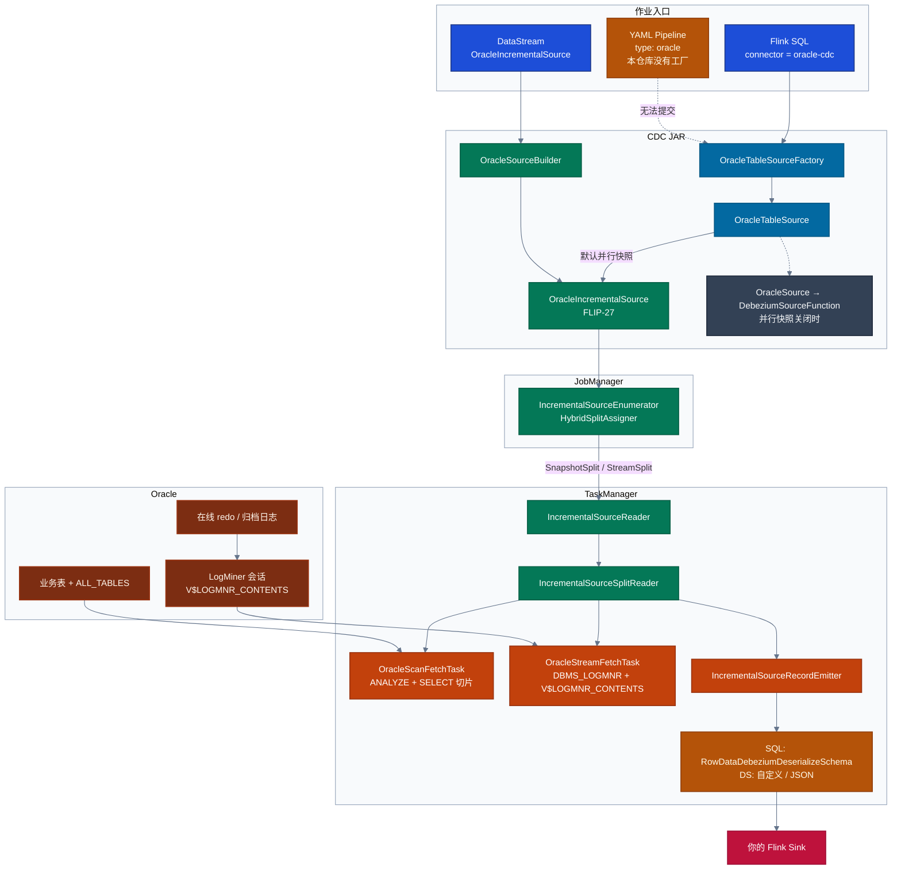
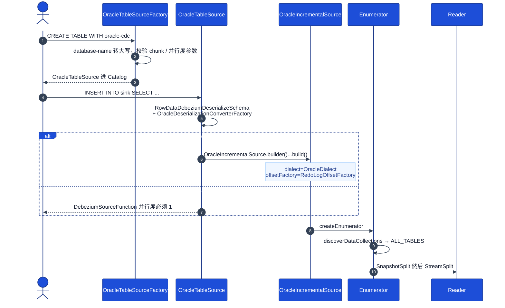
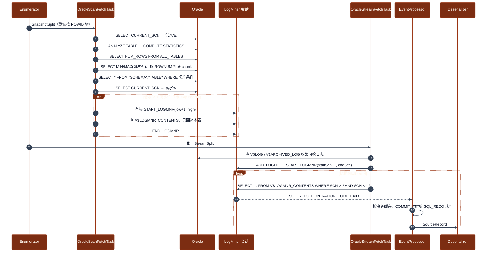

# Oracle CDC 完整流程（YAML / SQL / DataStream）与框架 SQL 清单

本文对应本仓库 **Flink CDC 3.2.1 + Debezium 2.7.4.Final + Flink 1.18.1**。Oracle 读取引擎在 `flink-connector-oracle-cdc`，增量走 **LogMiner**，位点是 **SCN**（`RedoLogOffset`）。

先把三条产品路径说清楚：

| 路径 | 本仓库能不能用 | 入口 |
| --- | --- | --- |
| Flink SQL `connector = 'oracle-cdc'` | 能 | `OracleTableSourceFactory` |
| DataStream `OracleIncrementalSource` | 能 | `OracleSourceBuilder.build()` |
| YAML Pipeline `type: oracle` | **不能** | 3.2.1 没有 `flink-cdc-pipeline-connector-oracle`，`ServiceLoader` 找不到 `DataSourceFactory` |

YAML 整库同步、路由、`SchemaRegistry` 只对 MySQL 等 Pipeline 连接器成立。Oracle 在本版本里只能当 **Flink Source**，Sink 仍是你自己接的 JDBC / Kafka / Paimon。架构边界见 [Flink作业内嵌CDC架构导读](Flink作业内嵌CDC架构导读.md)。

---

## 1. 总架构

Oracle 不走 MySQL 那套 `MySqlSource`。它走公共增量框架：

```text
OracleIncrementalSource
  extends JdbcIncrementalSource
    extends IncrementalSource
```

方言是 `OracleDialect`：切分用 `OracleChunkSplitter`，快照任务 `OracleScanFetchTask`，增量任务 `OracleStreamFetchTask`（内部是 `LogMinerStreamingChangeEventSource`）。位点工厂是 `RedoLogOffsetFactory`，字段为 `scn`、`commit_scn`、`lcr_position`。



依赖：`flink-sql-connector-oracle-cdc`（或 `flink-connector-oracle-cdc`）**不含 ojdbc**。还要自己放：

- `com.oracle.ojdbc:ojdbc8:19.3.0.0`
- `com.oracle.database.xml:xdb:19.3.0.0`

库侧必须 ARCHIVELOG，并对捕获表或库打开 supplemental logging。捕获用户需要 `LOGMINING`、`SELECT` 若干 `V_$` 视图、`EXECUTE` `DBMS_LOGMNR` / `DBMS_LOGMNR_D`。并行快照打开时不必 `LOCK ANY TABLE`。

---

## 2. YAML：本版本没有 Oracle Pipeline

`flink-cdc-connect/flink-cdc-pipeline-connectors` 下只有 mysql、values、doris、starrocks、kafka、elasticsearch、paimon。没有 oracle 的 `DataSourceFactory`。

若写：

```yaml
source:
  type: oracle
  hostname: 192.168.1.10
  port: 1521
  username: flinkuser
  password: flinkpw
  tables: DEBEZIUM.\.*
sink:
  type: kafka
pipeline:
  name: oracle-to-kafka
```

`FactoryDiscoveryUtils.getFactoryByIdentifier("oracle", DataSourceFactory.class)` 会抛「Cannot find factory with identifier oracle」。`flink-cdc.sh` 提交失败，不会连库。

要用 YAML 做整库同步，只能换支持 Oracle Pipeline 的更高版本，或自己实现 `DataSourceFactory` 把下面的 `OracleIncrementalSource` 包成 `Event`。本仓库请走 SQL 或 DataStream。

---

## 3. Flink SQL 完整流程

SPI：`META-INF/services/org.apache.flink.table.factories.Factory` → `OracleTableSourceFactory`，identifier = `oracle-cdc`。

### 3.1 作业示例

```sql
CREATE TABLE oracle_products (
  ID INT NOT NULL,
  NAME STRING,
  DESCRIPTION STRING,
  WEIGHT DECIMAL(10, 3),
  PRIMARY KEY (ID) NOT ENFORCED
) WITH (
  'connector' = 'oracle-cdc',
  'hostname' = 'localhost',
  'port' = '1521',
  'username' = 'flinkuser',
  'password' = 'flinkpw',
  'database-name' = 'ORCLCDB',          -- 会转成大写
  'schema-name' = 'DEBEZIUM',
  'table-name' = 'PRODUCTS',
  'scan.incremental.snapshot.enabled' = 'true',
  'scan.startup.mode' = 'initial',
  'debezium.log.mining.strategy' = 'online_catalog',
  'debezium.log.mining.continuous.mine' = 'true'
);

CREATE TABLE kafka_sink (
  ID INT,
  NAME STRING,
  DESCRIPTION STRING,
  WEIGHT DECIMAL(10, 3),
  PRIMARY KEY (ID) NOT ENFORCED
) WITH (
  'connector' = 'upsert-kafka',
  -- 其余 Kafka WITH 项
  'key.format' = 'json',
  'value.format' = 'json'
);

INSERT INTO kafka_sink SELECT * FROM oracle_products;
```

CDB + PDB 时加 `'debezium.database.pdb.name' = 'ORCLPDB1'`。Oracle 未加引号的列名是大写，Flink 表字段应写成 `ID` / `NAME`，不要写成 `id`。

`ChangelogMode.all()`：快照是 `+I`，更新是 `-U` 再 `+U`，删除是 `-D`。Sink 必须能接撤回，不能只接 append。

### 3.2 规划到运行时



`OracleTableSource.getScanRuntimeProvider` 里 `tableList` 拼成 `schemaName + "." + tableName`，例如 `DEBEZIUM.PRODUCTS`。启动模式只有 `initial`（先快照再 redo）和 `latest-offset`（只读增量）。不要同时配 `scan.startup.mode` 和 `debezium.snapshot.mode`。

关闭并行快照时走 `org.apache.flink.cdc.connectors.oracle.OracleSource`，内部 `DebeziumSourceFunction`，并把 `internal.log.mining.transaction.snapshot.boundary.mode=all`，`initial` 对应 `snapshot.mode=initial`，`latest-offset` 对应 `schema_only`。

---

## 4. DataStream 完整流程

并行快照（实验特性，默认 SQL 也走这条）：

```java
Properties debeziumProperties = new Properties();
debeziumProperties.setProperty("log.mining.strategy", "online_catalog");
debeziumProperties.setProperty("log.mining.continuous.mine", "true");

OracleSourceBuilder.OracleIncrementalSource<String> source =
        OracleSourceBuilder.OracleIncrementalSource.<String>builder()
                .hostname("localhost")
                .port(1521)
                .databaseList("ORCLCDB")
                .schemaList("DEBEZIUM")
                .tableList("DEBEZIUM.PRODUCTS")
                .username("flinkuser")
                .password("flinkpw")
                .deserializer(new JsonDebeziumDeserializationSchema())
                .includeSchemaChanges(true)
                .startupOptions(StartupOptions.initial())
                .debeziumProperties(debeziumProperties)
                .splitSize(8096)
                .build();

StreamExecutionEnvironment env = StreamExecutionEnvironment.getExecutionEnvironment();
env.enableCheckpointing(3000);
env.fromSource(source, WatermarkStrategy.noWatermarks(), "OracleIncrementalSource")
        .setParallelism(4)
        .sinkTo(/* 你的 Sink */);
env.execute("oracle-cdc-datastream");
```

旧单线程：

```java
DebeziumSourceFunction<String> source =
        OracleSource.<String>builder()
                .hostname("localhost")
                .port(1521)
                .database("ORCLCDB")
                .schemaList("DEBEZIUM")
                .tableList("DEBEZIUM.PRODUCTS")
                .username("flinkuser")
                .password("flinkpw")
                .deserializer(new JsonDebeziumDeserializationSchema())
                .build();
env.addSource(source); // 并行度 1
```

`OracleSourceBuilder.build()` 固定组装 `new RedoLogOffsetFactory()` 和 `new OracleDialect()`。

---

## 5. 运行时：快照切片 + LogMiner

`OracleDialect.createFetchTask`：快照分片 → `OracleScanFetchTask`，增量分片 → `OracleStreamFetchTask`。

水位在公共类 `AbstractScanFetchTask.execute`，SCN 来自 `OracleDialect.displayCurrentOffset` → `SELECT CURRENT_SCN FROM V$DATABASE`。



默认切片键是伪列 `ROWID`（`ChunkUtils.getChunkKeyColumn`），不是主键。可用 `scan.incremental.snapshot.chunk-key-column` 改成主键列。近似行数靠 `ANALYZE TABLE` + `ALL_TABLES.NUM_ROWS`，不是 `COUNT(*)`。

增量只有一个 StreamSplit。`EventProcessorFactory` 给 Memory / Infinispan 处理器加了「到达分片结束 SCN 就停」的判断，快照回补才是有界挖掘；持续捕获时结束偏移是 `RedoLogOffset.NO_STOPPING_OFFSET`。

本仓库把 Debezium 的 `LogMinerQueryBuilder`、`LogMinerStreamingChangeEventSource`、`LogMinerAdapter`、`MemoryLogMinerEventProcessor` 拷进 `io.debezium.connector.oracle`。`LogMinerAdapter` 相对上游 2.7.4 的改动：未决事务探测用 `START_SCN <= CURRENT_SCN`，避免刚好卡在当前 SCN 的事务漏掉。`LobRollbackResolver` 处理 LOB 保存点回滚。其余 `SqlUtils`、`OracleConnection`、`LogFileCollector` 仍来自 Maven 依赖 `debezium-connector-oracle:2.7.4.Final`。

---

## 6. 日志怎么解析

框架**不执行** redo 里的 SQL。流程是：

1. `DBMS_LOGMNR.START_LOGMNR` 按 SCN 窗口装好日志和字典。
2. 查询 `V$LOGMNR_CONTENTS`，Oracle 把 redo 还原成 `SQL_REDO` 文本，并带上 `OPERATION_CODE`、`XID`、`SCN`、`CSF` 等。
3. `CSF = 1` 时多行拼成一条完整 `SQL_REDO`。
4. `MemoryLogMinerEventProcessor`（或 Infinispan 缓冲）按 `XID` 攒事务：`START` 开事务，DML 进缓存，`COMMIT` 再解析下发，`ROLLBACK` 丢弃。
5. DML 解析器读 `SQL_REDO` 得到列值，组装 Kafka Connect `SourceRecord`。LOB 额外处理 `SELECT_LOB_LOCATOR` / `LOB_WRITE` / `LOB_TRIM` / `LOB_ERASE`；保存点回滚走 `LobRollbackResolver`。
6. `RowDataDebeziumDeserializeSchema` 或 `JsonDebeziumDeserializationSchema` 变成 Flink 记录。

`OPERATION_CODE`（`V$LOGMNR_CONTENTS`，查询侧）：

| 码 | 含义 | 无 LOB 时是否捕获 |
| --- | --- | --- |
| 0 | INTERNAL（LOB 语句边界，本仓库在 LOB+MEMORY 时额外捕获） | 否 |
| 1 | INSERT | 是 |
| 2 | UPDATE | 是 |
| 3 | DELETE | 是 |
| 5 | DDL（排除 `INFO LIKE 'INTERNAL DDL%'`） | 是 |
| 6 | START（事务开始；MEMORY 缓冲会去掉，避免无意义开事务） | 视缓冲类型 |
| 7 | COMMIT | 是 |
| 9 / 10 / 11 / 29 | SEL_LOB_LOCATOR / LOB_WRITE / LOB_TRIM / LOB_ERASE | 仅 `lob.enabled=true` |
| 34 | MISSING_SCN | 是 |
| 36 | ROLLBACK | 是 |
| 68 / 70 / 71 | XML_BEGIN / XML_WRITE / XML_END | 仅 LOB 模式 |
| 255 | UNSUPPORTED | 是 |

挖掘窗口绑定两个参数：`SCN > ?`（开区间下界）且 `SCN <= ?`（闭区间上界）。`START_LOGMNR` 的 `startScn` 会 **+1**，因为 LogMiner 的下界是包含的，框架把作业里的 start SCN 当排除下界。

`online_catalog` 用在线数据字典，DDL 跟踪弱，必须表结构相对稳定。`redo_log_catalog` 会先 `DBMS_LOGMNR_D.BUILD` 把字典写进 redo，能跟 DDL，但会触发额外日志切换，且 redo 建议 ≥ 500MB（`logOnlineRedoLogSizes` 用 `V$LOG.BYTES` 检查）。

---

## 7. 框架发出的全部 Oracle SQL

下列为运行时真实发送的语句（测试 DDL、用户 `INSERT INTO sink` 不算）。占位符用 `?` 或 `{...}`。

### 7.1 会话与容器

| 时机 | SQL | 位置 |
| --- | --- | --- |
| 切到 PDB | `alter session set container={pdbName}` | `OracleConnection.setSessionToPdb` |
| 回到 CDB | `alter session set container=cdb$root` | `OracleConnection.resetSessionToCdb` |
| NLS（挖矿前） | `ALTER SESSION SET NLS_DATE_FORMAT = 'YYYY-MM-DD HH24:MI:SS' NLS_TIMESTAMP_FORMAT = 'YYYY-MM-DD HH24:MI:SS.FF' NLS_TIMESTAMP_TZ_FORMAT = 'YYYY-MM-DD HH24:MI:SS.FF TZH:TZM' NLS_NUMERIC_CHARACTERS = '.,'` | `LogMinerStreamingChangeEventSource.setNlsSessionParameters` |
| UTC | `ALTER SESSION SET TIME_ZONE = '00:00'` | 同上 |
| 版本 ≥18 | `SELECT BANNER_FULL FROM V$VERSION WHERE BANNER_FULL LIKE 'Oracle Database%'` | `OracleConnection.resolveOracleDatabaseVersion` |
| 版本回退 | `SELECT BANNER FROM V$VERSION WHERE BANNER LIKE 'Oracle Database%'` | 同上 |
| 库时间 | `SELECT SYSTIMESTAMP FROM DUAL` | `getDatabaseSystemTime` |
| 当前时间戳 | `SELECT CURRENT_TIMESTAMP FROM DUAL` | `getCurrentTimestamp` |
| 国家字符集 | `select VALUE from NLS_DATABASE_PARAMETERS where PARAMETER = 'NLS_NCHAR_CHARACTERSET'` | `getNationalCharacterSet` |

JDBC `DatabaseMetaData.getDatabaseMajorVersion()` 无显式 SQL，驱动内部查版本。旧 Source 的 `OracleValidator` 用它限制大版本为 11 / 12 / 19 / 21。

### 7.2 SCN、归档模式、归档目标

| 用途 | SQL | 位置 |
| --- | --- | --- |
| 当前 SCN（水位、偏移） | `SELECT CURRENT_SCN FROM V$DATABASE` | `OracleConnectionUtils.SHOW_CURRENT_SCN`、`OracleConnection.getCurrentScn`、`LogMinerAdapter.getCurrentScn` |
| 是否 ARCHIVELOG | `SELECT LOG_MODE FROM V$DATABASE` | `OracleConnection.isArchiveLogMode` |
| SCN → 时间 | `SELECT scn_to_timestamp('{scn}') FROM DUAL` | `getScnToTimestamp` |
| 按毫秒回退 SCN | `SELECT timestamp_to_scn(scn_to_timestamp(?) - (? / 86400000)) FROM DUAL` | `getScnAdjustedByTime` |
| 按分钟丢弃长事务 | `select timestamp_to_scn(CAST(scn_to_timestamp({scn}) as date) - INTERVAL '{minutes}' MINUTE) from dual` | `SqlUtils.getScnByTimeDeltaQuery` |
| 指定归档目标是否有效 | `SELECT STATUS, TYPE FROM V$ARCHIVE_DEST_STATUS WHERE DEST_NAME=?` | `isArchiveLogDestinationValid` |
| 本地有效归档目标个数 | `SELECT COUNT(1) FROM V$ARCHIVE_DEST_STATUS WHERE STATUS='VALID' AND TYPE='LOCAL'` | `isOnlyOneArchiveLogDestinationValid` |
| 本地 DEST_ID 子查询 | `SELECT DEST_ID FROM V$ARCHIVE_DEST_STATUS WHERE STATUS='VALID' AND TYPE='LOCAL' AND ROWNUM=1` 或再加 `AND UPPER(DEST_NAME)='{name}'` | `SqlUtils.localArchiveLogDestinationsOnlyQuery` |

### 7.3 日志文件、大小、序列、补充日志

| 用途 | SQL | 位置 |
| --- | --- | --- |
| **redo 组大小** | `SELECT GROUP#, BYTES FROM V$LOG ORDER BY 1` | `logOnlineRedoLogSizes`（&lt;500MB 且 `redo_log_catalog` 时打警告） |
| 日志成员与状态 | `SELECT F.MEMBER, R.STATUS FROM V$LOGFILE F, V$LOG R WHERE F.GROUP# = R.GROUP# ORDER BY 2` | `SqlUtils.redoLogStatusQuery` |
| 当天归档切换次数 | `SELECT 'TOTAL', COUNT(1) FROM V$ARCHIVED_LOG WHERE FIRST_TIME > TRUNC(SYSDATE) AND DEST_ID IN ({本地 DEST_ID 子查询})` | `SqlUtils.switchHistoryQuery` |
| 当前 redo 文件名 | `SELECT F.MEMBER FROM V$LOG LOG, V$LOGFILE F WHERE LOG.GROUP#=F.GROUP# AND LOG.STATUS='CURRENT'` | `SqlUtils.currentRedoNameQuery` |
| 当前序列 | `SELECT SEQUENCE# FROM V$LOG WHERE STATUS = 'CURRENT' ORDER BY SEQUENCE#` | `SqlUtils.currentRedoLogSequenceQuery` |
| 库级 ALL supplemental | `SELECT 'KEY', SUPPLEMENTAL_LOG_DATA_ALL FROM V$DATABASE` | `databaseSupplementalLoggingAllCheckQuery` |
| 库级 MIN supplemental | `SELECT 'KEY', SUPPLEMENTAL_LOG_DATA_MIN FROM V$DATABASE` | `databaseSupplementalLoggingMinCheckQuery` |
| 表级补充日志组 | `SELECT 'KEY', LOG_GROUP_TYPE FROM ALL_LOG_GROUPS WHERE OWNER=? AND TABLE_NAME=?` | `tableSupplementalLoggingCheckQuery`（找 `ALL COLUMN LOGGING`） |
| 日志里最早 SCN | 见下方完整 SQL | `SqlUtils.oldestFirstChangeQuery` |
| **可挖掘日志列表（SCN 区间）** | 见下方完整 SQL | `SqlUtils.allMinableLogsQuery`，`LogFileCollector.getLogs(startScn)` |
| 指定线程/序列的归档 | `SELECT NAME, FIRST_CHANGE#, NEXT_CHANGE#, SEQUENCE# FROM V$ARCHIVED_LOG WHERE THREAD#=? AND SEQUENCE#=?` | `OracleConnection.getArchiveLogFile` |
| redo 线程 | `SELECT * FROM V$THREAD` | `getRedoThreadState` |

最早可用 SCN：

```sql
SELECT MIN(FIRST_CHANGE#) FROM (
  SELECT MIN(FIRST_CHANGE#) AS FIRST_CHANGE# FROM V$LOG
  UNION
  SELECT MIN(FIRST_CHANGE#) AS FIRST_CHANGE# FROM V$ARCHIVED_LOG
  WHERE DEST_ID IN ({本地 DEST_ID 子查询})
    AND STATUS='A'
    -- 若配置了归档保留小时数：
    AND FIRST_TIME >= SYSDATE - ({hours}/24)
)
```

可挖掘日志（在线 ∪ 归档）。`archiveLogOnlyMode` 为真时去掉 UNION 前半段。`{scn}` 是当前挖掘起点：

```sql
SELECT MIN(F.MEMBER) AS FILE_NAME, L.FIRST_CHANGE# FIRST_CHANGE, L.NEXT_CHANGE# NEXT_CHANGE,
       L.ARCHIVED, L.STATUS, 'ONLINE' AS TYPE, L.SEQUENCE# AS SEQ,
       'NO' AS DICT_START, 'NO' AS DICT_END, L.THREAD# AS THREAD
FROM V$LOGFILE F, V$LOG L
LEFT JOIN V$ARCHIVED_LOG A
  ON A.FIRST_CHANGE# = L.FIRST_CHANGE# AND A.NEXT_CHANGE# = L.NEXT_CHANGE#
WHERE (A.STATUS <> 'A' OR A.FIRST_CHANGE# IS NULL)
  AND L.STATUS != 'UNUSED'
  AND F.GROUP# = L.GROUP#
GROUP BY F.GROUP#, L.FIRST_CHANGE#, L.NEXT_CHANGE#, L.STATUS, L.ARCHIVED, L.SEQUENCE#, L.THREAD#
UNION
SELECT A.NAME AS FILE_NAME, A.FIRST_CHANGE# FIRST_CHANGE, A.NEXT_CHANGE# NEXT_CHANGE, 'YES',
       NULL, 'ARCHIVED', A.SEQUENCE# AS SEQ, A.DICTIONARY_BEGIN, A.DICTIONARY_END, A.THREAD# AS THREAD
FROM V$ARCHIVED_LOG A
WHERE A.NAME IS NOT NULL
  AND A.ARCHIVED = 'YES'
  AND A.STATUS = 'A'
  AND A.NEXT_CHANGE# > {scn}
  AND A.DEST_ID IN ({本地 DEST_ID 子查询})
  -- 可选：AND A.FIRST_TIME >= SYSDATE - ({hours}/24)
ORDER BY 7
```

`FIRST_CHANGE#` / `NEXT_CHANGE#` 就是每份日志覆盖的 SCN 区间。挖掘会话只加入 `NEXT_CHANGE# > startScn` 的文件。

### 7.4 LogMiner 会话

| 用途 | SQL | 位置 |
| --- | --- | --- |
| 把字典写入 redo（`redo_log_catalog`） | `BEGIN DBMS_LOGMNR_D.BUILD (options => DBMS_LOGMNR_D.STORE_IN_REDO_LOGS); END;` | `buildDataDictionary` |
| 加入日志文件 | `BEGIN sys.dbms_logmnr.add_logfile(LOGFILENAME => '{path}', OPTIONS => DBMS_LOGMNR.ADDFILE);END;` | `SqlUtils.addLogFileStatement` |
| 开始挖掘（持续捕获） | 见下 | `SqlUtils.startLogMinerStatement` |
| 快照边界探测用在线字典开会话 | `BEGIN sys.dbms_logmnr.start_logmnr(OPTIONS => DBMS_LOGMNR.DICT_FROM_ONLINE_CATALOG + DBMS_LOGMNR.NO_ROWID_IN_STMT);END;` | `LogMinerAdapter.startSession` |
| 结束会话 | `BEGIN SYS.DBMS_LOGMNR.END_LOGMNR(); END;` | `endMiningSession` / `stopSession` |
| 当前会话已加入的文件 | `SELECT FILENAME AS NAME FROM V$LOGMNR_LOGS` | `removeAllLogFilesFromLogMinerSession` |
| 移出文件 | `BEGIN SYS.DBMS_LOGMNR.REMOVE_LOGFILE(LOGFILENAME => '{path}');END;` | 同上、`deleteLogFileStatement` |
| 启动失败参数 | `SELECT START_SCN, END_SCN, REQUIRED_START_SCN, OPTIONS, STATUS, INFO FROM V$LOGMNR_PARAMETERS` | `LogMinerDatabaseStateWriter` |
| 损坏/失败的日志 | `SELECT FILENAME, THREAD_ID, THREAD_SQN, LOW_SCN, NEXT_SCN, DICTIONARY_BEGIN, DICTIONARY_END, TYPE, INFO FROM V$LOGMNR_LOGS WHERE STATUS = 4 ORDER BY THREAD_ID, THREAD_SQN` | 同上 |
| DEBUG 转储 | `SELECT * FROM V$LOGFILE`；`SELECT * FROM V$ARCHIVED_LOG WHERE FIRST_TIME >= SYSDATE - 2`；`SELECT * FROM V$LOG`；`SELECT * FROM V$LOG_HISTORY WHERE FIRST_TIME >= SYSDATE - 1` | 同上 |

`START_LOGMNR` 模板（`startScn` 已是作业 start+1）：

```sql
BEGIN sys.dbms_logmnr.start_logmnr(
  startScn => '{startScnInclusive}',
  endScn   => '{endScnInclusive}',
  OPTIONS  => {miningStrategy} + DBMS_LOGMNR.NO_ROWID_IN_STMT);
END;
```

`miningStrategy`：

- `online_catalog`：`DBMS_LOGMNR.DICT_FROM_ONLINE_CATALOG`
- `redo_log_catalog`：`DBMS_LOGMNR.DICT_FROM_REDO_LOGS + DBMS_LOGMNR.DDL_DICT_TRACKING`
- `log.mining.continuous.mine=true` 再加 `+ DBMS_LOGMNR.CONTINUOUS_MINE`（12c 起连续挖矿已弃用，文档仍常见）

### 7.5 解析日志：`V$LOGMNR_CONTENTS`

`LogMinerQueryBuilder.build` 生成（两个绑定：下界开、上界闭）：

```sql
SELECT SCN, SQL_REDO, OPERATION_CODE, TIMESTAMP, XID, CSF,
       TABLE_NAME, SEG_OWNER, OPERATION, USERNAME, ROW_ID, ROLLBACK,
       RS_ID, STATUS, INFO, SSN, THREAD#, DATA_OBJ#, DATA_OBJV#, DATA_OBJD#
FROM V$LOGMNR_CONTENTS
WHERE SCN > ? AND SCN <= ?
  -- PDB：AND SRC_CON_NAME = '{pdb}'
  AND (
        OPERATION_CODE IN (1,2,3,7,34,36,255)   -- 无 LOB + MEMORY 缓冲；有 LOB 时再加 6,9,10,11,29,68,70,71
        -- LOB+MEMORY 额外：OR (OPERATION_CODE = 0 AND ROLLBACK = 0 AND ROW_ID NOT LIKE '%AAAAAAAAAAAA' AND SEQUENCE# > 1)
        OR (OPERATION_CODE = 5 AND INFO NOT LIKE 'INTERNAL DDL%')
      )
  -- 可选用户/schema/table 的 IN 或 REGEXP_LIKE
  -- schema 默认排除 APPQOSSYS、AUDSYS、CTXSYS、DVSYS、DBSFWUSER、DBSNMP、GSMADMIN_INTERNAL、LBACSYS、MDSYS、OJVMSYS、OLAPSYS、ORDDATA、ORDPLUGINS、ORDSYS、OUTLN、SYS、SYSTEM、WMSYS、XDB 等
```

快照边界找跨越 SCN 的未决事务：

```sql
SELECT d.CURRENT_SCN, t.XID, t.START_SCN
FROM V$DATABASE d
LEFT OUTER JOIN V$TRANSACTION t    -- RAC 时为 GV$TRANSACTION
  ON t.START_SCN < d.CURRENT_SCN   -- 本仓库拷贝改为 START_SCN <= 语义，见 LogMinerAdapter 注释
```

以及（开过临时挖掘会话之后）：

```sql
SELECT START_SCN, XID
FROM V$LOGMNR_CONTENTS
WHERE OPERATION_CODE = 7
  AND SCN >= {currentScn}
  AND START_SCN <= {currentScn}
```

`START_SCN = 0` 的事务会被丢掉，避免归档不够时挖到“时间起点”。

混合策略下 Recycle Bin：

```sql
SELECT OWNER, ORIGINAL_NAME FROM DBA_RECYCLEBIN WHERE OBJECT_NAME=?
```

### 7.6 发现表、统计、切片、快照扫描

| 用途 | SQL | 位置 |
| --- | --- | --- |
| 发现捕获表 | `SELECT OWNER, TABLE_NAME, TABLESPACE_NAME FROM ALL_TABLES WHERE TABLESPACE_NAME IS NOT NULL AND TABLESPACE_NAME NOT IN ('SYSTEM','SYSAUX') AND NESTED = 'NO' AND TABLE_NAME NOT IN (SELECT PARENT_TABLE_NAME FROM ALL_NESTED_TABLES)` | `OracleConnectionUtils.listTables` |
| 表是否存在 | `SELECT COUNT(1) FROM USER_TABLES WHERE TABLE_NAME=?` 或 `SELECT COUNT(1) FROM ALL_TABLES WHERE OWNER=? AND TABLE_NAME=?` | `OracleConnection.isTableExists` |
| 是否关系表 | `SELECT COUNT(1) FROM ALL_ALL_TABLES WHERE OWNER=? AND TABLE_NAME=? AND TABLE_TYPE IS NULL` | `getTableMetadataDdl` |
| 精确行数（旧快照/判空） | `SELECT COUNT(1) FROM "{SCHEMA}"."{TABLE}"` | `getRowCount` |
| **近似行数（并行切片）** | `analyze table "{SCHEMA}"."{TABLE}" compute statistics for table` 然后 `select NUM_ROWS from all_tables where TABLE_NAME = '{TABLE}'` | `OracleUtils.queryApproximateRowCnt` |
| 切片列最小最大 | `SELECT MIN("{COL}"), MAX("{COL}") FROM "{SCHEMA}"."{TABLE}"` | `JdbcChunkUtils.queryMinMax`，`OracleChunkSplitter` |
| 下一 chunk 上界 | `SELECT MAX("{COL}") FROM (SELECT "{COL}" FROM "{SCHEMA}"."{TABLE}" WHERE "{COL}" >= ? ORDER BY "{COL}" ASC) WHERE ROWNUM <= {chunkSize}` | `OracleUtils.queryNextChunkMax` |
| 大于某值的最小键 | `SELECT MIN("{COL}") FROM "{SCHEMA}"."{TABLE}" WHERE "{COL}" > ?` | `JdbcChunkUtils.queryMin` |
| 快照扫描（整表一个分片） | `SELECT * FROM "{SCHEMA}"."{TABLE}"` | `OracleUtils.buildSplitScanQuery` |
| 快照扫描（首片） | `SELECT * FROM "{SCHEMA}"."{TABLE}" WHERE {pk} <= ? AND NOT ({pk} = ?)` | 同上 |
| 快照扫描（尾片） | `SELECT * FROM "{SCHEMA}"."{TABLE}" WHERE {pk} >= ?` | 同上 |
| 快照扫描（中间片） | `SELECT * FROM "{SCHEMA}"."{TABLE}" WHERE {pk} >= ? AND NOT ({pk} = ?) AND {pk} <= ?` | 同上 |

默认 `{COL}` 是 `ROWID`。`buildSelectWithRowLimits` 里的 `LIMIT` 对 Oracle 无效，实际快照读取走上面的 `ROWNUM` / 无 LIMIT 全表扫描。旧 `DebeziumSourceFunction` 快照用 `OracleConnection.buildSelectWithRowLimits`：11g 为 `SELECT * FROM (SELECT … ORDER BY …) WHERE ROWNUM <= n`，12c+ 为 `FETCH NEXT n ROWS ONLY`。

### 7.7 表结构（JDBC 元数据 + DBMS_METADATA）

`OracleSchema.readTable` 调用 `OracleConnection.readSchema`，底层是 JDBC：

- `DatabaseMetaData.getTables(null, schemaPattern, table, …)`
- `getColumns(null, schema, table, …)`
- `getPrimaryKeys` / `getIndexInfo`（唯一索引，过滤 `SYS_NC$`、ADT、`M_ROW$$`）

驱动会访问 `ALL_TABLES`、`ALL_TAB_COLUMNS`、`ALL_CONS_COLUMNS`、`ALL_CONSTRAINTS`、`ALL_INDEXES`、`ALL_IND_COLUMNS` 等，SQL 文本由 ojdbc 生成，本仓库不写死。

显式字典 SQL：

```sql
begin dbms_metadata.set_transform_param(DBMS_METADATA.SESSION_TRANSFORM, 'STORAGE', false); end;
begin dbms_metadata.set_transform_param(DBMS_METADATA.SESSION_TRANSFORM, 'SEGMENT_ATTRIBUTES', false); end;
begin dbms_metadata.set_transform_param(DBMS_METADATA.SESSION_TRANSFORM, 'SQLTERMINATOR', true); end;
SELECT dbms_metadata.get_ddl('TABLE', ?, ?) FROM DUAL;
begin dbms_metadata.set_transform_param(DBMS_METADATA.SESSION_TRANSFORM, 'DEFAULT'); end;

SELECT OBJECT_ID, DATA_OBJECT_ID FROM ALL_OBJECTS WHERE OBJECT_NAME=? AND OWNER=? AND OBJECT_TYPE=?;
SELECT OBJECT_ID FROM ALL_OBJECTS WHERE OBJECT_TYPE='TABLE' AND OWNER=? AND OBJECT_NAME=?;
SELECT DATA_OBJECT_ID FROM ALL_OBJECTS WHERE OBJECT_TYPE='TABLE' AND OWNER=? AND OBJECT_NAME=?;
```

LOB 列回查（有 commit SCN 时闪回）：

```sql
SELECT {cols} FROM (SELECT * FROM "{SCHEMA}"."{TABLE}" AS OF SCN ?) WHERE {pk}=?
-- ORA-01555 时退回：
SELECT {cols} FROM "{SCHEMA}"."{TABLE}" WHERE {pk}=?
```

### 7.8 其它

| 用途 | SQL | 位置 |
| --- | --- | --- |
| 会话统计 | `SELECT VALUE FROM v$statname n, v$mystat m WHERE n.name='{name}' AND n.statistic#=m.statistic#` | `getSessionStatisticByName` |
| LGWR 刷新 | 非 RAC 一般是该连接上 `COMMIT`（无业务 SQL）；RAC 会对各节点连接提交 | `CommitLogWriterFlushStrategy` / `RacCommitLogWriterFlushStrategy` |

只读挖掘（`log.mining.read.only`）不刷 LGWR。

---

## 8. 库侧必须先执行的 SQL（不是框架发出，但没有则上面语句会失败）

非 CDB 摘要（CDB 加 `CONTAINER=ALL` / PDB tablespace）：

```sql
ALTER DATABASE ARCHIVELOG;
ALTER DATABASE ADD SUPPLEMENTAL LOG DATA;
ALTER TABLE {schema}.{table} ADD SUPPLEMENTAL LOG DATA (ALL) COLUMNS;

CREATE USER flinkuser IDENTIFIED BY flinkpw ...;
GRANT CREATE SESSION, SET CONTAINER, FLASHBACK ANY TABLE,
      SELECT ANY TABLE, SELECT ANY TRANSACTION, LOGMINING,
      SELECT_CATALOG_ROLE, EXECUTE_CATALOG_ROLE,
      CREATE TABLE, CREATE SEQUENCE, ANALYZE ANY TO flinkuser;
GRANT EXECUTE ON DBMS_LOGMNR TO flinkuser;
GRANT EXECUTE ON DBMS_LOGMNR_D TO flinkuser;
GRANT SELECT ON V_$DATABASE, V_$LOG, V_$LOG_HISTORY, V_$LOGFILE,
      V_$ARCHIVED_LOG, V_$ARCHIVE_DEST_STATUS,
      V_$LOGMNR_LOGS, V_$LOGMNR_CONTENTS, V_$LOGMNR_PARAMETERS TO flinkuser;
```

并行快照默认打开，不必 `LOCK ANY TABLE`。`ANALYZE ANY` 给切片统计用。

---

## 9. 关键代码

| 环节 | 类 |
| --- | --- |
| SQL SPI | `OracleTableSourceFactory` / `OracleTableSource` |
| FLIP-27 Source | `OracleSourceBuilder.OracleIncrementalSource` |
| 方言 | `OracleDialect` |
| 切片 | `OracleChunkSplitter`、`OracleUtils`、`ChunkUtils` |
| 快照 | `OracleScanFetchTask`、`AbstractScanFetchTask` |
| 增量 | `OracleStreamFetchTask`、`LogMinerStreamingChangeEventSource` |
| 挖矿 SQL 生成 | `LogMinerQueryBuilder`、`io.debezium...logminer.SqlUtils`（依赖 jar） |
| 日志列表 / SCN 窗口 | `SqlUtils.allMinableLogsQuery`、`LogFileCollector` |
| 事务与 LOB | `MemoryLogMinerEventProcessor`、`LobRollbackResolver` |
| 位点 | `RedoLogOffset`（`SELECT CURRENT_SCN FROM V$DATABASE`） |
| 连接与字典 | `OracleConnection`、`OracleSchema` |
| 旧单线程 | `org.apache.flink.cdc.connectors.oracle.OracleSource` → `DebeziumSourceFunction` |

建议断点：`OracleDialect.createFetchTask` → `AbstractScanFetchTask.execute`（看三次 SCN）→ `LogMinerStreamingChangeEventSource.startMiningSession` → `LogMinerQueryBuilder.build` → `MemoryLogMinerEventProcessor.processRow`。
