# Flink CDC 3.2.1 源码架构导读

本文对应本仓库 **Flink CDC 3.2.1 + Debezium 2.7.4.Final + Flink 1.18.1**。图和调用顺序都按当前源码，而不是早期宣传图。

先记住一句话：

> **从 `flink-cdc-cli` 的 `CliFrontend` 进入。** 它只负责把 YAML 翻译成 Flink 作业并提交。作业跑起来之后，组件调度分成三块：Source 的 SplitEnumerator 分快照/增量切片，`SchemaRegistry` 串行协调表结构变更，Sink Writer 在 flush 完成后才允许下游改表。

---

## 1. 从哪个模块进入

仓库有两条产品入口，共用同一套「快照 + 增量」读取引擎。

| 你想学什么 | 第一站 | 为什么从这里进 |
| --- | --- | --- |
| YAML 整库同步、路由、转换、schema 演进 | `flink-cdc-cli` → `CliFrontend.main` | 3.x Pipeline 的唯一进程入口 |
| 作业图怎么被拼出来 | `flink-cdc-composer` → `FlinkPipelineComposer.compose` | 所有算子在这里按固定顺序挂上 DataStream |
| 表结构变更怎么卡住上下游 | `flink-cdc-runtime` → `SchemaOperator` + `SchemaRegistry` | 框架自己的 OperatorCoordinator |
| MySQL binlog / 并行快照 | `flink-connector-mysql-cdc` → `MySqlSource` | MySQL 有独立实现，不走公共 `IncrementalSource` |
| PostgreSQL / Oracle / SQL Server / Db2 / MongoDB | `flink-cdc-base` → `IncrementalSource` | 公共 FLIP-27 框架，各库只补 Dialect |
| Flink SQL `connector = 'mysql-cdc'` | `MySqlTableSourceFactory` | Table API 的 SPI 入口，内部仍调用同一个 `MySqlSource` |

建议阅读顺序：

1. `CliFrontend` → `CliExecutor` → `FlinkPipelineComposer.compose`，先把作业图画在纸上。
2. `SchemaOperator.processElement` 和 `SchemaRegistryRequestHandler`，理解框架如何调度 Source 与 Sink。
3. 再下钻 `MySqlDataSource` → `MySqlSource` → Enumerator / Reader。
4. 最后看 `flink-cdc-base` 的 `IncrementalSource`，对照 MySQL 实现理解公共抽象。

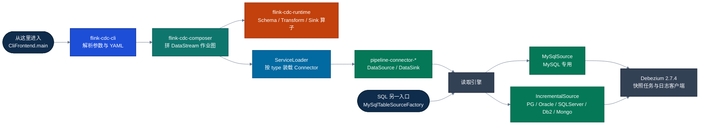

---

## 2. 模块地图

父 POM `flink-cdc-parent` 的模块划分就是架构边界。

| 模块 | 角色 | 学习时把它当成 |
| --- | --- | --- |
| `flink-cdc-cli` | `flink-cdc.sh` 拉起的客户端 | 提交器，不是作业本身 |
| `flink-cdc-common` | `Event`、`DataSource`、`DataSink`、类型系统 | 框架契约，connector 只能依赖它 |
| `flink-cdc-composer` | YAML 定义 → Flink 作业图 | 调度蓝图 |
| `flink-cdc-runtime` | Schema / Transform / Partition / Sink 算子 | 作业里的框架算子 |
| `flink-cdc-connect/flink-cdc-source-connectors` | SQL Source，`mysql-cdc` 等 | 读引擎 + Table Factory |
| `flink-cdc-connect/flink-cdc-pipeline-connectors` | YAML 里的 `type: mysql/doris/...` | 把读引擎或写入封装成 `DataSource` / `DataSink` |
| `flink-cdc-dist` | `bin/flink-cdc.sh`、`conf/flink-cdc.yaml` | 发行包脚本 |
| `flink-cdc-e2e-tests`、`flink-cdc-migration-tests` | 测试 | 对照行为，不必先读 |

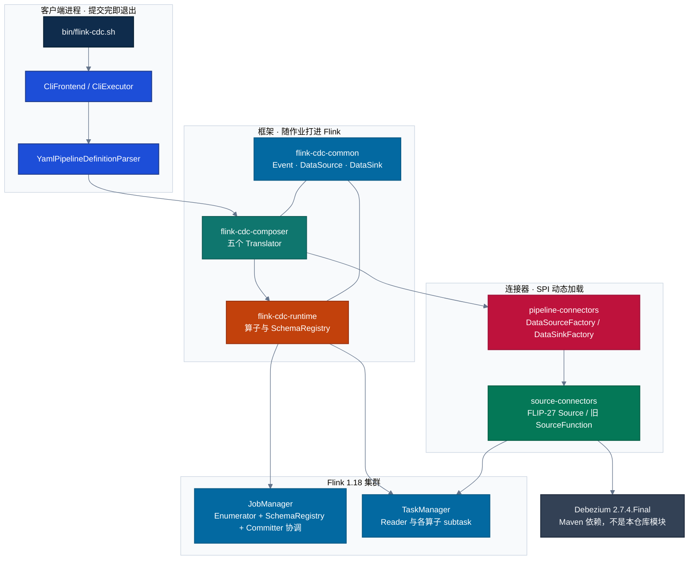

---

## 3. 整体走向

### 3.1 Pipeline：从脚本到作业

`flink-cdc-dist/.../bin/flink-cdc.sh` 把 `FLINK_HOME/lib` 与 `FLINK_CDC_HOME/lib` 拼进 classpath，然后执行：

```text
org.apache.flink.cdc.cli.CliFrontend
```

`CliFrontend.main` 解析 `--flink-home`、全局配置、savepoint、额外 JAR，交给 `CliExecutor.run`。

`CliExecutor.run` 有两条岔路：

- 带部署目标（`--target` 一类部署模式）：`ComposeDeploymentFactory` 把作业部署到 YARN / Kubernetes，不在本地组图。
- 普通提交：`YamlPipelineDefinitionParser.parse` 得到 `PipelineDef`，`FlinkPipelineComposer.compose` 组图，`FlinkPipelineExecution.execute` 调用 `StreamExecutionEnvironment.executeAsync`。

YAML 五个顶层键直接对应 `PipelineDef` 的字段：

| YAML | 解析结果 | 之后谁消费 |
| --- | --- | --- |
| `source` | `SourceDef` | `DataSourceTranslator` |
| `sink` | `SinkDef` | `DataSinkTranslator` |
| `route` | `List<RouteDef>` | `SchemaOperator` 做表名改写 |
| `transform` | `List<TransformDef>` | Pre/Post Transform |
| `pipeline` | 并行度、作业名、时区、schema 策略、UDF | `PipelineOptions` |

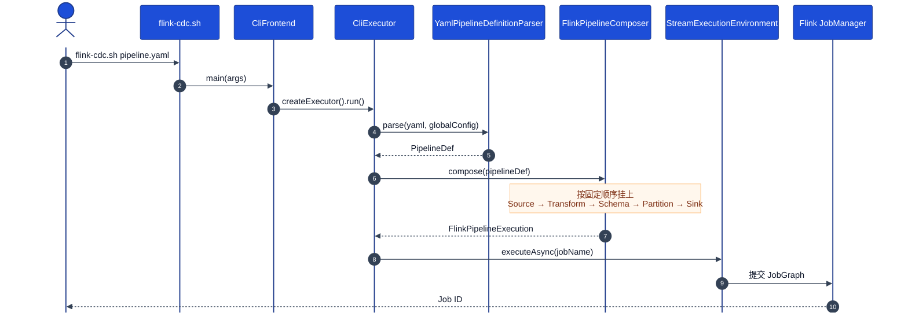

### 3.2 作业图：算子真实顺序

`FlinkPipelineComposer.compose`（约 90–163 行）的顺序就是运行时数据流。没有 `transform` 时，两个 Transform 算子会被跳过。

```text
Source
  → PreTransformOperator     名字 Transform:Schema   改写 SchemaChangeEvent
  → PostTransformOperator    名字 Transform:Data     过滤并投影 DataChangeEvent
  → SchemaOperator           路由 + 向 SchemaRegistry 申请演进
  → PrePartitionOperator     Schema/Flush 广播，数据按主键哈希
  → EventPartitioner         partitionCustom
  → PostPartitionProcessor   拆回 Event
  → DataSinkWriterOperator   写入；两阶段 sink 后面还有 Committer
```

Schema 算子放在 Transform **之后**。下游看到的表结构，已经是投影、过滤之后的结构。`MetadataApplier` 在建 Sink 时提前拿出来，传给 `SchemaOperatorFactory`，因为改表动作发生在框架侧，而不是某个 Sink subtask 里。


五个 Translator 与代码位置：

| 顺序 | 类 | 关键方法 | 产出 |
| --- | --- | --- | --- |
| 1 | `DataSourceTranslator` | `translate` / `createDataSource` | `env.fromSource` 或 `addSource` |
| 2 | `TransformTranslator` | `translatePreTransform` | `PreTransformOperator` |
| 3 | `TransformTranslator` | `translatePostTransform` | `PostTransformOperator` |
| 4 | `DataSinkTranslator` | `createDataSink` | 先创建 `DataSink`，还不挂算子 |
| 5 | `SchemaOperatorTranslator` | `translate` | `SchemaOperatorFactory`（带 Coordinator） |
| 6 | `PartitioningTranslator` | `translate` | PrePartition + `partitionCustom` + PostPartition |
| 7 | `DataSinkTranslator` | `translate` / `sinkTo` | `DataSinkWriterOperatorFactory` |

### 3.3 SQL Source：另一条入口，同一颗引擎

`CREATE TABLE ... WITH ('connector' = 'mysql-cdc')` 不经过 CLI。Flink 通过 `META-INF/services/org.apache.flink.table.factories.Factory` 找到 `MySqlTableSourceFactory`（identifier = `mysql-cdc`），再进 `MySqlTableSource.getScanRuntimeProvider`：

- `scan.incremental.snapshot.enabled = true`（默认并行读）：构建 `MySqlSource`，走 FLIP-27。
- 关闭并行读：构建旧的 `org.apache.flink.cdc.connectors.mysql.MySqlSource`，内部是 `DebeziumSourceFunction`，单并行度、锁与位点都在 SourceFunction 状态里。

Pipeline 的 `type: mysql` 走另一套 SPI：`META-INF/services/org.apache.flink.cdc.common.factories.Factory`，`MySqlDataSourceFactory` 的 identifier 是 `mysql`。它创建 `MySqlDataSource`，里面仍然 `new MySqlSource`，只是反序列化目标从 `RowData` 换成了框架的 `Event`（`MySqlEventDeserializer` + `MySqlPipelineRecordEmitter`）。

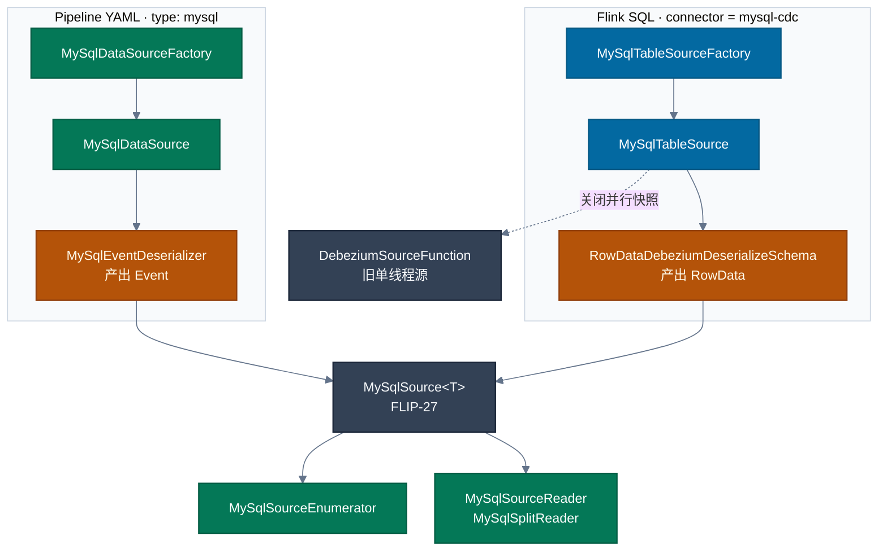

---

## 4. 事件：框架里流动的唯一数据

`org.apache.flink.cdc.common.event.Event` 是空接口。Pipeline 作业从头到尾传递的就是它，序列化由 `EventSerializer` 负责。

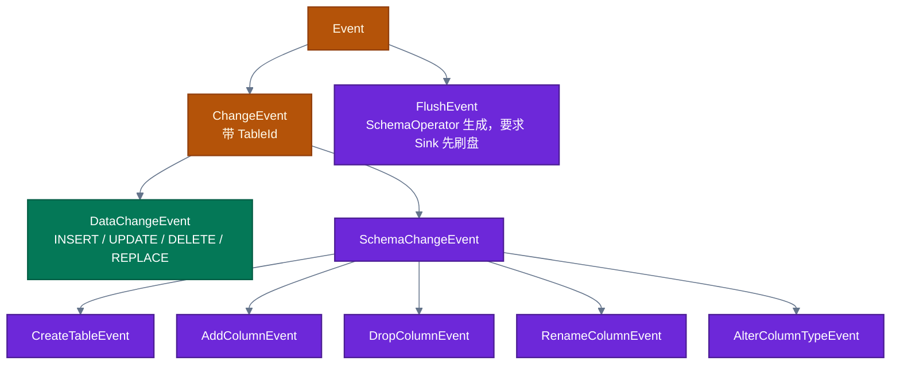

`SchemaChangeBehavior`（`pipeline.schema.change.behavior`，默认 `LENIENT`）决定 `SchemaRegistry` 对结构事件的态度：

| 取值 | 行为 |
| --- | --- |
| `IGNORE` | 丢掉全部结构变更 |
| `LENIENT` | 尽量下发，失败也继续跑 |
| `TRY_EVOLVE` | 下发，失败继续 |
| `EVOLVE` | 下发，要求 Sink 能处理 |
| `EXCEPTION` | 除 `CreateTableEvent` 外直接让作业失败 |

---

## 5. 框架如何调度各个 CDC 组件

CLI 进程不调度算子。作业提交后，Flink 按 JobGraph 把组件放到两类进程里。

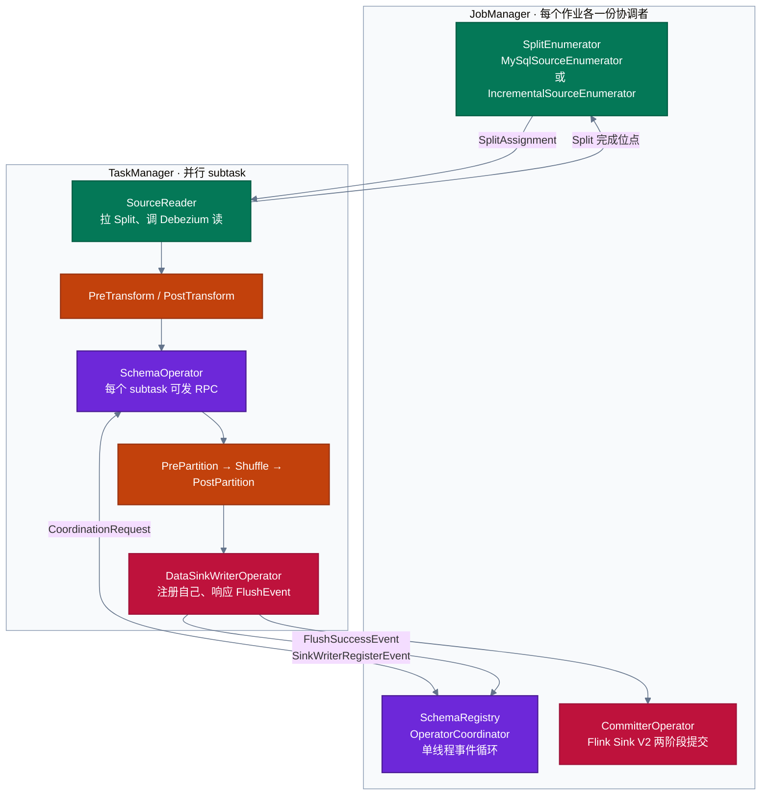

三套调度互不替代：

1. **分片调度**：Enumerator 在 JobManager，Reader 在 TaskManager。快照分片可并行，增量分片全局只有一个（MySQL 叫 `binlog-split`，公共框架叫 `stream-split`）。
2. **结构调度**：`SchemaOperatorFactory.getCoordinatorProvider` 注册 `SchemaRegistryProvider`。所有 Schema 算子 subtask 和所有 Sink Writer 都通过 `SchemaEvolutionClient` 找同一个 Coordinator。Coordinator 用单线程执行器串行处理请求，避免并发 DDL。
3. **写入调度**：普通 `Sink` 只有 Writer。实现了 `TwoPhaseCommittingSink` 的连接器还会被 `DataSinkTranslator.addCommittingTopology` 接上 Flink 的 `CommitterOperatorFactory`，checkpoint 时提交。

### 5.1 Connector 是怎么被挂上的

`FactoryDiscoveryUtils.getFactoryByIdentifier` 使用 `ServiceLoader.load(Factory.class)`，用 YAML 里的 `type` 匹配 `Factory.identifier()`，并且要求类型是 `DataSourceFactory` 或 `DataSinkFactory`。

本仓库 Pipeline SPI：

| identifier | 工厂 | 方向 |
| --- | --- | --- |
| `mysql` | `MySqlDataSourceFactory` | Source |
| `values` | `ValuesDataFactory` | Source + Sink |
| `doris` | `DorisDataSinkFactory` | Sink |
| `starrocks` | `StarRocksDataSinkFactory` | Sink |
| `kafka` | `KafkaDataSinkFactory` | Sink |
| `elasticsearch` | `ElasticsearchDataSinkFactory` | Sink |
| `paimon` | `PaimonDataSinkFactory` | Sink |

`DataSourceTranslator.createDataSource` 找到工厂后，还会把该工厂所在 JAR 加进 Flink 环境，这样 TaskManager 上才有 connector 类。

`DataSource` 只有两个方法：

- `getEventSourceProvider()`：返回 `FlinkSourceProvider`（FLIP-27 `Source`）或 `FlinkSourceFunctionProvider`（旧 SourceFunction）。
- `getMetadataAccessor()`：枚举库表、读取当前 schema。作业启动时的建表事件由 Source 侧发出，Accessor 给连接器实现「先看元数据」的能力。

`DataSink` 对称地提供 `getEventSinkProvider()`、`getMetadataApplier()`，以及 `getDataChangeEventHashFunctionProvider()`。最后一个决定数据在进 Sink 之前按什么键分区，默认实现按表和主键哈希。

### 5.2 Transform 做的事

| 算子 | 看到 SchemaChangeEvent | 看到 DataChangeEvent |
| --- | --- | --- |
| `PreTransformOperator` | 按 projection 改写结构，缓存源表 schema | 只做列裁剪，保证后面的结构事件和行数据列一致 |
| `PostTransformOperator` | 再按规则调整 schema 缓存 | 执行 filter 与 projection，可调用 UDF |

表达式解析在 `flink-cdc-runtime` 的 `TransformParser`，底层是 Calcite（`TransformSqlOperatorTable`）。UDF 来自 YAML `pipeline.user-defined-function`，在 `Cli` 解析成 `UdfDef` 后传给两个 Transform。

### 5.3 分区规则

`PrePartitionOperator.processElement`：

- `SchemaChangeEvent`、`FlushEvent`：广播到下游每一个并行度，保证每个 Sink subtask 都看得到建表、改表和刷盘信号。
- `DataChangeEvent`：用 Sink 提供的 `HashFunction` 计算分区。分区数等于下游并行度。

因此「一张表的主键有序」靠哈希，而「改表先于新数据」靠广播加上 Schema 协调，不靠 Flink 的 keyBy 本身。

---

## 6. Schema 演进：框架调度 Sink 的关键路径

这是 Pipeline 相对于 SQL Source 多出来的核心。SQL Source 把变更日志直接交给 Flink SQL 的 changelog，不会在框架里对下游执行 DDL。

一次被接受的结构变更：

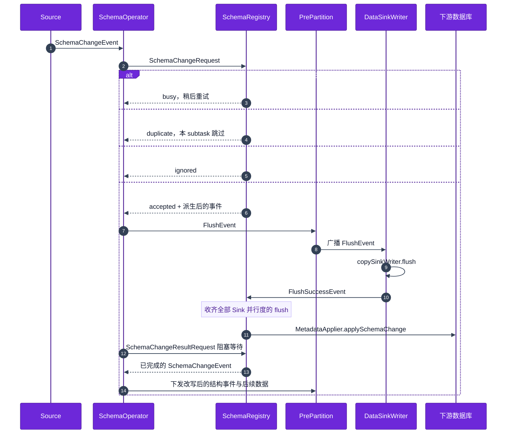

对应代码：

| 步骤 | 位置 |
| --- | --- |
| 区分结构事件和数据事件 | `SchemaOperator.processElement` |
| 发 RPC、发 `FlushEvent`、等待结果 | `SchemaOperator.handleSchemaChangeEvent` |
| 单线程收请求、去重、派生、等 flush | `SchemaRegistryRequestHandler.handleSchemaChangeRequest` |
| 收齐 flush 后调用 `metadataApplier.applySchemaChange` | `SchemaRegistryRequestHandler.flushSuccess` / `applySchemaChange` |
| Sink 刷盘并回执 | `DataSinkWriterOperator.handleFlushEvent` |
| 作业恢复时向 Registry 要最新 schema，补一条 `CreateTableEvent` | `DataSinkWriterOperator.emitLatestSchema` |
| 表名路由与列对齐 | `SchemaOperator.getRoutedTables`、`regenerateRecordData` |
| 原始 schema 与演进后 schema | `SchemaManager`、`SchemaDerivation` |

`handleSchemaChangeEvent` 在当前 subtask 上是阻塞的：同一条流里，这张表的后续数据要等这次 DDL 完成才继续往下发。Registry 同时只处理一个请求，其他 subtask 收到 `busy` 后循环重试，直到超时（`pipeline.schema-operator.rpc-timeout`）。

数据事件不走这套 RPC。`processDataChangeEvents` 用缓存把源表列布局改成路由之后、演进之后的布局，缺列补 null，类型不一致时做兼容转换。

---

## 7. 读取引擎：快照分片 + 一条增量流

### 7.1 两套实现，同一套思想

| | MySQL | PostgreSQL / Oracle / SQL Server / Db2 / MongoDB |
| --- | --- | --- |
| 入口类 | `MySqlSource` | `JdbcIncrementalSource` 或 `MongoDBSource`，都继承 `IncrementalSource` |
| Enumerator | `MySqlSourceEnumerator` | `IncrementalSourceEnumerator`（Postgres 有子类） |
| 混合分配器 | `MySqlHybridSplitAssigner` | `HybridSplitAssigner` |
| 快照分配器 | `MySqlSnapshotSplitAssigner` | `SnapshotSplitAssigner` |
| Reader | `MySqlSourceReader` + `MySqlSplitReader` | `IncrementalSourceReader` + `IncrementalSourceSplitReader` |
| 快照读取 | `SnapshotSplitReader` → `MySqlSnapshotSplitReadTask` | Dialect.`createFetchTask` → `IncrementalSourceScanFetcher` |
| 增量读取 | `BinlogSplitReader` → `MySqlBinlogSplitReadTask` | `IncrementalSourceStreamFetcher` |
| 增量位点 | `BinlogOffset` | 各库 `Offset` / `OffsetFactory` |

OceanBase、TiDB 仍是 `RichSourceFunction` / 自有 SourceFunction。Vitess 仍包一层 `DebeziumSourceFunction`。它们没有进入上面的分片框架。

`IncrementalSource.createEnumerator`：

- 启动模式不是 pure stream：`discoverDataCollections` 找出表，交给 `HybridSplitAssigner`。
- `startupOptions.isStreamOnly()`：只建 `StreamSplitAssigner`。
- 从 checkpoint 恢复时，按 `HybridPendingSplitsState` 或 `StreamPendingSplitsState` 还原分配器。

`MySqlSource.createEnumerator` 是同一形状，类名换成 MySQL 自己的 Assigner。

### 7.2 分配器状态机

`AssignerStatus` 描述「先分完快照，再交出唯一的增量分片；运行中还可以发现新表」。

```mermaid
%%{init: {'theme':'base','themeVariables':{'fontFamily':'Segoe UI, PingFang SC, Microsoft YaHei, sans-serif','fontSize':'14px','lineColor':'#64748B'},'flowchart':{'curve':'basis','padding':12,'nodeSpacing':24,'rankSpacing':36,'htmlLabels':true}}}%%
stateDiagram-v2
    direction LR
    [*] --> INITIAL_ASSIGNING
    INITIAL_ASSIGNING --> INITIAL_ASSIGNING_FINISHED: 快照分片分完 onFinish
    INITIAL_ASSIGNING_FINISHED --> NEWLY_ADDED_ASSIGNING: 发现新表
    NEWLY_ADDED_ASSIGNING --> NEWLY_ADDED_ASSIGNING_SNAPSHOT_FINISHED: 新表快照分完
    NEWLY_ADDED_ASSIGNING_SNAPSHOT_FINISHED --> NEWLY_ADDED_ASSIGNING_FINISHED: 增量分片已更新
    NEWLY_ADDED_ASSIGNING_FINISHED --> NEWLY_ADDED_ASSIGNING: 又发现新表

    classDef run fill:#FEF3C7,stroke:#B45309,color:#78350F,stroke-width:1.5px
    classDef done fill:#D1FAE5,stroke:#047857,color:#064E3B,stroke-width:1.5px
    class INITIAL_ASSIGNING,NEWLY_ADDED_ASSIGNING run
    class INITIAL_ASSIGNING_FINISHED,NEWLY_ADDED_ASSIGNING_SNAPSHOT_FINISHED,NEWLY_ADDED_ASSIGNING_FINISHED done
```

`HybridSplitAssigner.getNext` 的门闩：

1. 还有快照分片：只从 `SnapshotSplitAssigner` 取，按主键范围和 chunk size 切。
2. 快照还没全部完成：不发增量分片，避免同一主键的增量先于快照到达。
3. 初始分配结束且增量分片还没发过：创建唯一的 `StreamSplit` / `MySqlBinlogSplit`。它带着每个已完成快照分片的高水位，用来回补快照期间的日志。
4. 新表场景：不新建第二条增量流，而是更新已有增量分片，并暂时挂起 binlog reader（`MySqlSplitReader.suspendBinlogReaderIfNeed`）。

### 7.3 MySQL 快照水位

无锁一致性靠低水位和高水位，而不是 `FLUSH TABLES WITH READ LOCK`。逻辑在 `MySqlSnapshotSplitReadTask.doExecute`。

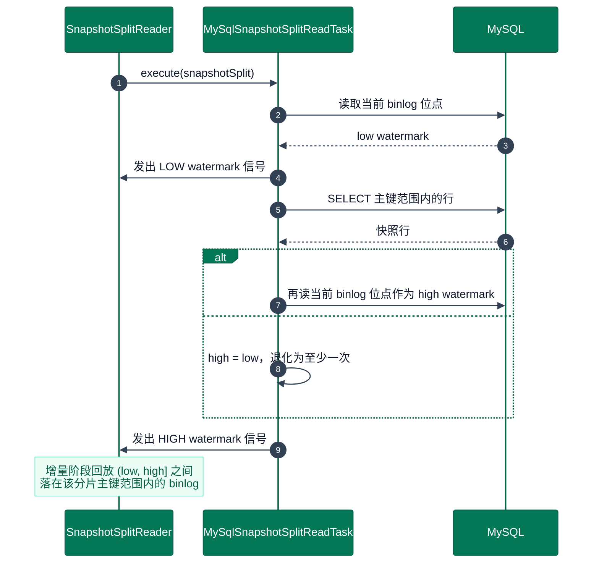

步骤对应源码日志：

1. `Snapshot step 1`：`DebeziumUtils.currentBinlogOffset` 记下低水位。
2. `Snapshot step 2`：`createDataEvents` 按分片主键区间查表。
3. `Snapshot step 3`：再取一次位点作为高水位。`scan.incremental.snapshot.backfill.skip` 打开时高水位直接等于低水位，注释写明此时只能保证至少一次。

增量阶段 `MySqlBinlogSplitReadTask` 继承 Debezium 的 `MySqlStreamingChangeEventSource`，从所有分片低水位的最小值开始读 binlog，按每个分片的高水位做回补，然后进入持续捕获。`BinlogSplitReader` 使用 `BinaryLogClient`。

公共框架里，`IncrementalSourceSplitReader.pollSplitRecords` 在当前快照分片读完后切到 `IncrementalSourceStreamFetcher`，有新快照分片时再切回去。Dialect 通过 `createFetchTask` 决定具体的 Debezium 任务（LogMiner、pgoutput 等）。

### 7.4 Reader 线程模型

FLIP-27 的 `SourceReaderBase` 把「分片线程」和「主输出线程」拆开：

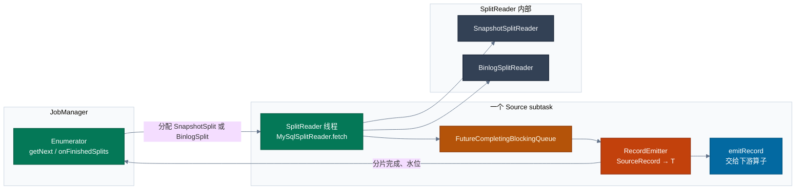

 checkpoint 时 Enumerator 保存 `PendingSplitsState`（还有哪些分片、增量分片发过没有、已完成分片的高水位），Reader 保存当前分片读取进度。恢复后 `restoreEnumerator` 按状态重建 Assigner，未完成的快照分片会重新分配。

---

## 8. 关键代码索引

按调用顺序列出，路径均相对于仓库根目录。

### 提交与组图

| 节点 | 文件 |
| --- | --- |
| 脚本入口 | `flink-cdc-dist/src/main/flink-cdc-bin/bin/flink-cdc.sh` |
| `main` | `flink-cdc-cli/src/main/java/org/apache/flink/cdc/cli/CliFrontend.java` |
| 解析或部署 | `flink-cdc-cli/.../CliExecutor.java` |
| YAML → `PipelineDef` | `flink-cdc-cli/.../parser/YamlPipelineDefinitionParser.java` |
| 作业图 | `flink-cdc-composer/.../flink/FlinkPipelineComposer.java` 的 `compose` |
| 提交 | `flink-cdc-composer/.../flink/FlinkPipelineExecution.java` |
| SPI | `flink-cdc-composer/.../utils/FactoryDiscoveryUtils.java` |

### 运行时算子

| 节点 | 文件 |
| --- | --- |
| 结构协调算子 | `flink-cdc-runtime/.../operators/schema/SchemaOperator.java` |
| 注册 Coordinator | `.../schema/SchemaOperatorFactory.java` |
| Coordinator | `.../schema/coordinator/SchemaRegistry.java` |
| 请求处理 | `.../schema/coordinator/SchemaRegistryRequestHandler.java` |
| 结构改写 | `.../operators/transform/PreTransformOperator.java` |
| 数据改写 | `.../operators/transform/PostTransformOperator.java` |
| 广播与哈希 | `.../partitioning/PrePartitionOperator.java` |
| Sink 包装 | `.../operators/sink/DataSinkWriterOperator.java` |
| 契约 | `flink-cdc-common/.../source/DataSource.java`、`.../sink/DataSink.java` |

### MySQL 读取引擎

| 节点 | 文件 |
| --- | --- |
| Pipeline 封装 | `flink-cdc-pipeline-connector-mysql/.../source/MySqlDataSource.java` |
| SQL 封装 | `flink-connector-mysql-cdc/.../table/MySqlTableSource.java` |
| FLIP-27 Source | `flink-connector-mysql-cdc/.../source/MySqlSource.java` |
| 混合分配 | `.../source/assigners/MySqlHybridSplitAssigner.java` |
| 分片读取 | `.../source/reader/MySqlSplitReader.java` |
| 快照水位 | `.../debezium/task/MySqlSnapshotSplitReadTask.java` |
| Binlog | `.../debezium/task/MySqlBinlogSplitReadTask.java` |

### 公共增量框架

| 节点 | 文件 |
| --- | --- |
| Source | `flink-cdc-base/.../source/IncrementalSource.java` |
| JDBC 子类 | `.../source/jdbc/JdbcIncrementalSource.java` |
| 分配器 | `.../source/assigner/HybridSplitAssigner.java` |
| 状态机 | `.../source/assigner/AssignerStatus.java` |
| 读切换 | `.../source/reader/IncrementalSourceSplitReader.java` |
| Oracle / PG / SQL Server / Db2 | 各自 `*SourceBuilder` 里的 `*IncrementalSource` |
| MongoDB | `flink-connector-mongodb-cdc/.../MongoDBSource.java` |

---

## 9. 建议的源码走读路线

每一段都只追一条调用链，追完再进入下一段。

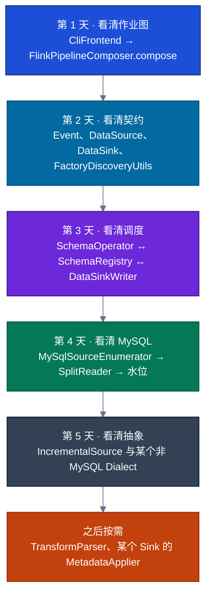

1. **作业图。** 只读 `FlinkPipelineComposer.compose`。在 IDE 里给七次 `translate` 打断点，确认没有 transform 时中间两步被跳过。
2. **契约。** 读 `PipelineDef`、`DataSource`、`DataSink`、`FactoryDiscoveryUtils`。用 `type: mysql` 跟到 `MySqlDataSourceFactory.identifier`。
3. **调度。** 从 `SchemaOperator.handleSchemaChangeEvent` 跟到 `SchemaRegistry.handleEventFromOperator`，再跟到 `DataSinkWriterOperator.handleFlushEvent`。把 busy / duplicate / ignored / accepted 四种返回值对上。
4. **MySQL。** 从 `MySqlSource.createEnumerator` 跟到 `MySqlHybridSplitAssigner.getNext`，再跟 `MySqlSplitReader.pollSplitRecords` 和 `MySqlSnapshotSplitReadTask.doExecute`。
5. **公共框架。** 打开 `IncrementalSource.createReader` / `createEnumerator`，选 PostgreSQL 或 Oracle 的 Dialect，看 `createFetchTask` 如何替换 MySQL 的 Binlog 任务。
6. **按需深入。** 转换表达式看 `PostTransformOperator.processDataChangeEvent`；某个下游看它的 `MetadataApplier.applySchemaChange` 和 `EventSinkProvider`。

调试 Pipeline 时优先看算子名：`Flink CDC Event Source: mysql`、`Transform:Schema`、`Transform:Data`、`SchemaOperator`、`PrePartition`、`PostPartition`、`Sink Writer:`、`Sink Committer:`。这些字符串都在对应 Translator 里。
